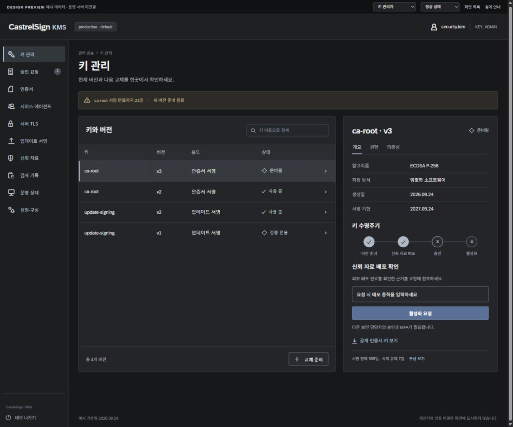
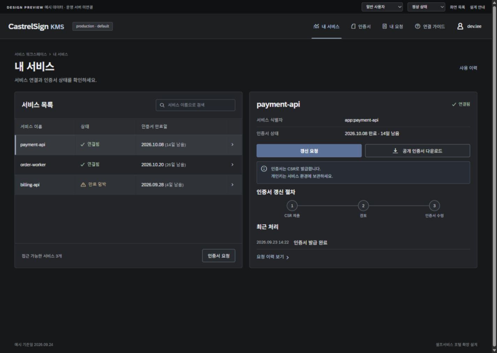
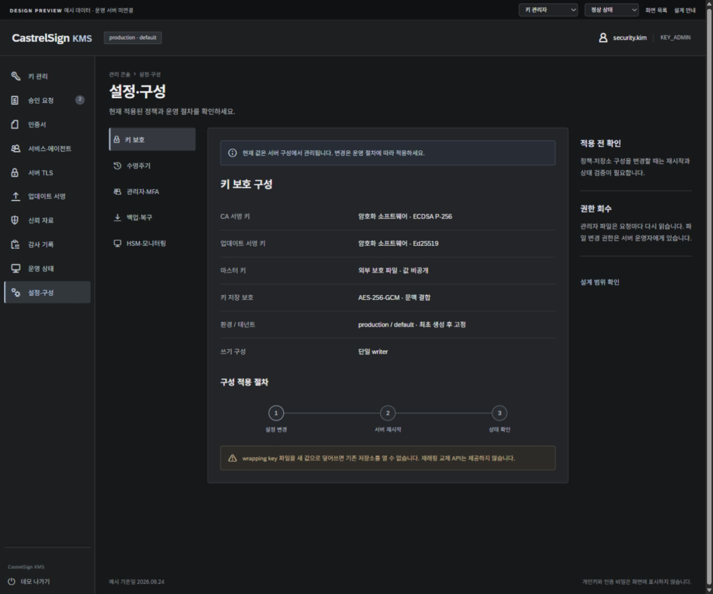

# CastrelSign KMS 화면 설계

확정된 1번 시안을 바탕으로 **관리자 20개, 사용자 7개, 공통 진입 1개**의 화면·탭을 구체화했습니다. SAP Fundamental Styles와 Evening Horizon Dark를 적용하고, 무채색 중심의 사용자 정의 색상으로 조정했습니다.

- [실행 중인 프로토타입](http://127.0.0.1:4317/)
- [전체 화면 상세 설계서](screen_spec.md)
- [프로토타입 실행·구조 안내](prototype/README.md)
- [화면 검증 보고서](prototype/design-qa.md)
- [확정한 디자인 시안](reference/selected-dark.png)

상단의 **화면 목록**에서 모든 화면을 탐색할 수 있습니다. **미리보기 역할**로 업무 역할을 전환하고, **화면 상태**로 로딩·빈 목록·오류·권한 없음 상태를 확인합니다. 변경 작업의 데모 MFA 코드는 `000000`입니다.

이 결과물은 화면 설계용 프론트엔드입니다. 운영 API를 호출하지 않으며 데이터는 새로고침하면 초기화됩니다. 인증서 다운로드는 실제 PEM 대신 설계 안내 텍스트를 반환합니다. 실제 키, 토큰, MFA 코드, 개인키를 입력하지 않습니다.

## 주요 화면

| 관리자 | 일반 사용자 |
| --- | --- |
| [키 목록과 상세](http://127.0.0.1:4317/#keys) | [내 서비스](http://127.0.0.1:4317/#services) |
| [2인 승인](http://127.0.0.1:4317/#approvals) | [CSR 요청](http://127.0.0.1:4317/#enroll) |
| [설정과 구성](http://127.0.0.1:4317/#settings) | [요청 이력](http://127.0.0.1:4317/#my-requests) |

주소만 변경하면 현재 역할은 유지됩니다. 관리자/사용자 전환은 상단 역할 선택 또는 화면 목록을 사용하세요.

## 화면 이미지

## 설계 기준

[SAP Fundamental Styles](https://sap.github.io/fundamental-styles/)의 shell, navigation, table, form, message, dialog 문법을 참고했습니다. 실제 패키지의 테마 변수·버튼·표·아이콘 CSS와 SAP 72 글꼴을 사용합니다. 제품 로고는 텍스트 워드마크이며, 화면 안에 시안 이미지를 붙이는 방식으로 구현하지 않았습니다.

색상 조정과 화면별 API 범위는 상세 설계서에 기록했습니다. 기존 백엔드 구현 결과는 [구현 완료 보고서](../implementation_report.md)와 별도로 유지합니다.
