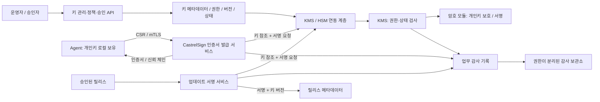

# Key Management System(KMS)의 역할과 기능 요구사항

- 작성·인터넷 자료 확인일: 2026-09-23
- 대상 프로젝트: CastrelSign
- 목적: KMS가 제공해야 할 기능을 설명하고, CastrelSign의 인증서 발급·업데이트 서명 구조에 적용할 요구사항을 제안한다.
- 조사 범위: NIST, OASIS, IETF, OWASP 및 AWS·Google Cloud·Microsoft·Oracle의 공식 문서

## 1. 문서의 범위와 읽는 방법

이 문서에서 KMS는 **암호키와 관련 메타데이터를 생성부터 폐기까지 관리하고, 허용된 주체만 정해진 용도로 사용하도록 통제하는 시스템**을 뜻한다. 클라우드의 Key Management Service도 이 역할을 수행하는 구현 형태다. 키를 저장하는 데이터베이스뿐 아니라 정책, 운영 절차, 접근 권한, 암호 연산, 장애 복구까지 함께 고려한다. [NIST SP 800-57 Part 1 Rev. 5][S01]

내용은 다음 세 종류로 구분한다.

| 구분 | 의미 |
| --- | --- |
| 일반 요구사항 | KMS를 설계하거나 도입할 때 검토해야 하는 기능과 운영 조건 |
| 공식 구현 사례 | 특정 제품의 기능을 설명하는 예시. 모든 KMS에 동일한 API·제한·기본값이 있다는 뜻은 아니다. |
| CastrelSign 제안 | 현재 저장소의 문서·소스와 조사 결과를 바탕으로 작성한 설계 제안. 이미 구현되었다는 의미는 아니다. |

본문의 **필수**는 이 보고서가 제안하는 운영용 KMS의 기본 요구사항이다. **조건부**는 암호화 저장, 외부 키 반입, 외부 시스템 연동 등 해당 사용 사례를 채택할 때 필요한 기능이다. 이를 특정 법률의 일괄적인 의무나 모든 표준의 공통 인증 기준으로 해석해서는 안 된다. NIST SP 800-130도 CKMS 설계에서 무엇을 명세해야 하는지를 다루는 프레임워크다. [NIST SP 800-130][S02]

## 2. KMS의 역할과 다른 시스템과의 관계

### 2.1 KMS가 해결하는 문제

암호 알고리즘이 안전하더라도 키가 소스 코드, 설정 파일, 로그, 백업에 노출되거나 권한 없는 서비스가 키를 사용하면 보호 효과가 사라진다. 반대로 암호화 키를 잃으면 정상 사용자도 데이터를 복구하지 못할 수 있다. KMS의 역할은 **키의 기밀성·무결성·가용성을 함께 관리하는 것**이다. OWASP 역시 애플리케이션이 필요로 하는 보안 목적과 키 처리 위치를 먼저 파악하도록 안내한다. [OWASP Key Management Cheat Sheet][S03]

운영 관점에서는 다음 질문에 답할 수 있어야 한다.

1. 어떤 키가 존재하며, 어떤 데이터·인증서·서비스를 보호하는가?
2. 누가 키를 만들고 변경하며, 누가 실제 암호 연산에 사용하는가?
3. 키 원문은 어디에 존재하고, 어떤 경로로 이동하는가?
4. 언제 교체해야 하며, 이전 키가 필요한 데이터는 얼마나 남아 있는가?
5. 키가 유출되거나 저장소가 손상되면 무엇을 차단하고 어떻게 복구하는가?
6. 이러한 작업이 정책대로 수행되었다는 사실을 어떤 기록으로 확인하는가?

### 2.2 KMS·HSM·PKI·Secret Manager의 차이

| 구성요소 | 주요 역할 | KMS와의 관계 |
| --- | --- | --- |
| KMS | 키 목록, 버전, 권한, 수명주기, 암호 연산 접근, 감사 관리 | 키 관리의 정책·서비스 계층 |
| HSM(Hardware Security Module) | 보호된 하드웨어 경계 안에서 키를 보관하고 암호 연산 수행 | KMS의 키 보호·연산 기반으로 사용할 수 있다. |
| CA/PKI | 공개키와 주체를 인증서로 연결하고 발급·갱신·폐지·신뢰 경로 관리 | CA가 KMS/HSM의 개인키로 인증서를 서명할 수 있다. |
| Secret Manager | API 토큰, 비밀번호, 연결 문자열 등 비밀정보 저장·전달·교체 | KMS의 암호화 키를 사용해 비밀정보 저장소를 보호할 수 있다. |
| 애플리케이션 | 어떤 업무 요청을 허용할지 결정하고 데이터 형식을 처리 | KMS에 암호 연산을 요청하되 업무 승인 책임을 가진다. |

HSM을 사용한다고 키 소유자, 교체 정책, 감사 보존 정책까지 자동으로 정해지는 것은 아니다. 반대로 모든 KMS가 하드웨어 기반인 것도 아니다. 제품별 보호 수준과 지원 연산을 확인해야 한다. 인증서와 CRL의 형식·처리는 PKI 표준의 영역이며, 암호 모듈의 보호 요구사항은 FIPS 140-3 같은 별도의 기준에서 다룬다. [RFC 5280][S04], [FIPS 140-3][S05]

**CastrelSign에 대한 해석:** 현재 프로젝트는 CA/PKI와 서명 서비스의 성격이 강하다. KMS를 도입한다면 인증서 발급 정책은 CastrelSign이 수행하고, CA 키·업데이트 서명 키의 보호와 사용 권한은 KMS/HSM에 맡기는 구성이 가능하다. Agent가 자신의 개인키를 로컬에서 생성하는 모델도 그대로 유지할 수 있다.

## 3. 관리해야 하는 키와 메타데이터

### 3.1 키의 종류와 용도 분리

| 관리 대상 | 사용 목적 | 관리 시 주의점 |
| --- | --- | --- |
| 대칭 데이터 암호화 키(DEK) | 파일·레코드·백업 등의 실제 데이터 암호화 | 데이터 보존 기간과 복호화 필요성을 함께 관리한다. |
| 키 암호화 키(KEK) | DEK 등 다른 키를 암호화하여 보호 | 이 키의 손실·유출은 하위 키 전체에 영향을 줄 수 있다. |
| 비대칭 서명 개인키 | 인증서, 업데이트, 문서 등에 전자서명 | 사용 권한과 반출 경로를 엄격하게 제한한다. |
| 서명 검증 공개키 | 서명의 유효성 검증 | 기밀성보다 출처·무결성·버전 식별이 중요하다. |
| 비대칭 복호화 개인키 | 공개키로 보호한 데이터를 복호화 | 과거 데이터가 남아 있으면 이전 개인키도 필요할 수 있다. |
| MAC/HMAC 키 | 메시지 인증 코드 생성·검증 | 동일 비밀키를 공유하므로 공개키 서명과 신뢰 모델이 다르다. |
| 키 합의·파생 관련 키 | 프로토콜에 따라 세션·하위 키 생성 | 해당 프로토콜과 KDF의 입력·용도 제한을 함께 관리한다. |
| 신뢰 앵커·인증서 | 공개키를 신뢰할 근거와 사용 조건 제공 | 암호키 원문과 별도로 배포·갱신·폐지 상태를 관리한다. |

KMS는 키 종류에 맞는 연산만 허용해야 한다. 예를 들어 CA 서명 키를 일반 파일 암호화나 업데이트 서명에 재사용하지 않는 정책이 필요하다. 실제 제품도 키 유형과 알고리즘에 따라 가능한 연산을 구분한다. [Azure Key types, algorithms, and operations][S06]

### 3.2 키 원문과 관리 정보를 분리한다

다음은 CastrelSign에 적용할 수 있는 **메타데이터 설계안**이다. NIST의 키·메타데이터 관리 개념을 프로젝트 운영에 맞게 구체화했다. [NIST SP 800-130, §6][S02]

| 필드 | 설명 |
| --- | --- |
| `key_id`, `version_id` | 논리적인 키와 실제 키 버전을 구분하는 불변 식별자 |
| `alias` | 현재 사용할 키를 가리키는 운영용 이름. 과거 결과 검증에는 실제 버전 식별자를 사용한다. |
| `purpose`, `allowed_operations` | CA 서명·업데이트 서명·암호화 등 용도와 허용 연산 |
| `algorithm`, `parameters` | 알고리즘, 키 길이·곡선, 필요한 알고리즘 매개변수 |
| `owner`, `tenant_id`, `environment` | 책임 조직, 테넌트, 개발·검증·운영 환경 |
| `state`, `created_at`, `activated_at` | 현재 상태와 주요 전환 시각 |
| `protect_until`, `retain_until` | 새 데이터 보호에 사용할 기한과 기존 데이터 처리·보관 기한 |
| `origin`, `protection_level` | 자체 생성·반입 여부와 소프트웨어·HSM 등 보호 방식 |
| `provider_key_ref`, `export_policy` | 외부 공급자 키 참조와 반출 허용 정책 |
| `policy_version`, `rotation_policy` | 적용된 접근 정책과 교체 조건 |
| `public_key_fingerprint`, `certificate_refs` | 공개키·인증서와 연결하기 위한 정보 |
| `compromise_at`, `revocation_reason` | 사고 시점과 사용 중단 사유 |
| `dependency_refs`, `destruction_record` | 관련 서비스·데이터 및 폐기 증적 |

목록 조회 API는 이러한 관리 정보를 제공하되 개인키·비밀키 원문을 반환하지 않아야 한다. 또한 메타데이터의 변경만으로 다른 테넌트에 키가 귀속되거나 허용 용도가 확대되지 않도록 변경 권한과 이력을 관리한다.

## 4. 키 수명주기와 상태 관리

키 수명주기는 보통 생성·등록, 활성화, 사용, 사용 종료·보관, 파기로 이어진다. NIST SP 800-57은 이를 운영 전·운영·운영 후·파기 단계와 세부 상태로 설명한다. **교체된 키로 새 데이터를 보호하는 일과 이전 데이터를 처리하는 일은 구분해야 한다.** [NIST SP 800-57 Part 1 Rev. 5, §7–8][S01]

| 상태 개념 | 의미 | 서비스에서 처리할 사항 |
| --- | --- | --- |
| Pre-activation | 생성되었으나 일반 사용 전 | 검증·승인·배포 완료 전 사용 차단 |
| Active | 지정 용도로 사용 가능 | 권한과 사용 기간을 만족하는 연산 허용 |
| Suspended | 일시적으로 보호 작업 중단 | 재활성화 조건과 기존 데이터 처리 정책 명시 |
| Deactivated | 정상적인 신규 보호 사용 종료 | 필요할 때 과거 데이터 복호화·검증을 제한적으로 지원 |
| Compromised | 유출되었거나 신뢰할 수 없는 상태 | 신규 사용 차단, 영향 조사, 대체 키·신뢰정보 배포 |
| Destroyed | 키 재료가 파기된 상태 | 키를 사용하는 연산 거부, 필요한 관리 기록 보존 |

이는 개념적인 상태 설명이며 특정 제품 API의 상태 이름과 동일하지 않다. 서비스 구현에서는 `Disabled`, `PendingDeletion` 같은 추가 상태를 사용할 수 있다. 특히 **KMS API에서 Disabled가 된 키는 과거 데이터 복호화도 거부될 수 있으므로**, 보관용 키와 완전 비활성화 키의 의미를 명세해야 한다. [AWS KMS 키 삭제 문서][S07]

CastrelSign 상태 관리 설계에서는 다음을 요구한다.

- 상태별 허용 연산을 표로 정의하고, 실제 암호 연산 직전에 검사한다.
- 비활성화·권한 철회와 이미 진행 중인 요청 사이의 경계를 정의한다. 완료된 서명을 사후에 회수할 수는 없다.
- 비밀키 재료 파기와 공개키·인증서·감사 기록 삭제를 구분한다.
- 사용 중단·침해 상태를 오래된 백업 복원으로 되돌리지 않도록 상태 변경 이력을 복구 절차에 포함한다.
- 침해된 키의 복호화나 과거 서명 검증이 필요한 경우 일반 사용 경로와 분리된 사고 대응 정책을 적용한다.

## 5. KMS가 제공해야 하는 상세 기능

### 5.1 안전한 키 생성과 등록 — 필수

**목적:** 예측하기 어려운 키를 생성하고 소유자·용도·보호 수준을 처음부터 확정한다.

KMS는 검증된 암호 라이브러리나 암호 모듈의 난수 생성 기능을 사용해야 한다. 생성 요청에서는 알고리즘, 용도, 접근 정책을 지정하고 정책에 맞지 않는 조합을 거부한다. 키 쌍의 경우 공개키와 개인키가 올바르게 대응하는지도 확인할 수 있어야 한다. AWS KMS의 공식 구현 설명은 HSM 내부 키 생성과 난수 생성 구조를 제시한다. [AWS KMS cryptography essentials][S08]

CastrelSign 요구사항 제안:

- CA·서버 TLS·업데이트 서명 키를 서로 다른 키로 등록한다.
- 키 생성 결과는 `key_id`, 버전, 공개키, 보호 수준으로 반환한다. 보호 대상 개인키 반환을 기본 경로로 만들지 않는다.
- 같은 생성 요청을 재시도해 불필요한 키가 여러 개 생기지 않도록 요청 식별자와 결과 조회 방법을 제공한다.
- 공개키·인증서·키 참조 중 일부만 저장된 상태를 감지하고 복구한다. 기존 신뢰 키의 유실을 자동 신규 생성으로 덮어쓰지 않는다.
- 운영용 키와 테스트용 키를 구분하고 테스트 키가 운영 서명에 선택되지 않도록 한다.

### 5.2 키의 안전한 저장과 사용 중 보호 — 필수

**목적:** 저장소 복사, 백업 노출, 애플리케이션 침해가 곧 개인키 유출로 이어지는 범위를 줄인다.

KMS는 저장·전송·연산 시점의 보호 경계를 설명해야 한다. 고가치 키에는 HSM 내부 생성·연산과 비반출 정책을 검토한다. 소프트웨어 방식이라면 암호화된 저장과 별도 보호된 상위 키가 필요하다. KEK와 암호화된 키를 동일 권한·동일 설정 파일로 접근하게 하면 보호 효과가 제한된다. [OWASP 키 저장 지침][S03], [AWS KMS cryptography essentials][S08]

CastrelSign 요구사항 제안:

- CA 및 업데이트 서명 개인키를 애플리케이션이 바이트 배열로 읽지 않고 키 참조로 사용하도록 연산 인터페이스를 마련한다.
- 로그, 오류 메시지, 추적 데이터, 임시 파일, heap dump에 키 재료가 포함되지 않도록 한다.
- 불가피하게 메모리에 올라오는 비밀값은 보존 시간을 줄인다. Java의 객체 복사·GC 때문에 완전한 메모리 삭제를 보장한다고 표현하지 않는다.
- 파일 기반 개발 모드를 유지한다면 운영 모드와 명확히 구분하고 OS 접근 권한 및 백업 경로를 관리한다.
- 공급자의 비반출 보장이 일반 API 반출, 보호된 백업, HSM 간 복제 중 어디에 적용되는지 명시한다.

FIPS 140-3는 암호 모듈의 보안 요구사항이다. 알고리즘을 지원하거나 HSM을 사용한다는 사실만으로 CastrelSign 전체가 FIPS 인증을 받은 것은 아니다. 검증이 필요한 환경에서는 실제 모듈·버전·동작 모드·인증 범위를 확인해야 한다. [FIPS 140-3][S05], [NIST CMVP 검증 모듈 안내][S09]

### 5.3 인증·인가와 역할 분리 — 필수

**목적:** 키를 관리할 권한과 키로 서명·복호화할 권한을 따로 통제한다.

사람 운영자는 조직의 인증 체계와 연결하고, 서비스는 고유한 워크로드 신원으로 인증한다. 키별·연산별 권한과 최소 권한 원칙을 적용한다. Google Cloud KMS는 관리자와 암호 연산 역할을 구분하며, Azure도 관리 계층과 데이터 계층의 접근을 나누어 설명한다. [Google Cloud KMS IAM][S10], [Azure Key Vault RBAC][S11]

| 역할 설계 예시 | 허용 업무 | 기본적으로 제외할 업무 |
| --- | --- | --- |
| 키 관리자 | 키 생성, 교체 일정·메타데이터 관리 | 업무 데이터 복호화, 임의 서명 |
| 서명 서비스 | 지정된 키와 용도로 서명 | 키 삭제, 정책 변경, 개인키 반출 |
| 보안 승인자 | 파기·고위험 정책 변경 승인 | 단독으로 승인과 실행 모두 수행 |
| 감사자 | 이벤트·정책 이력 조회 | 키 사용, 이벤트 삭제 |
| 복구 담당자 | 승인된 복구 절차 실행 | 평상시 키 추출·업무 서명 |

이 역할표는 CastrelSign 제안이다. 관리자에게 자기 권한을 확장할 수 있는 정책 변경 권한이 남아 있으면 역할 분리의 효과가 약해진다. 따라서 권한 부여 경로도 별도 승인·감사 대상에 포함한다. 테넌트 식별자는 요청 본문만 신뢰하지 않고 인증된 주체와 대조한다. 루트 키 파기·대규모 권한 변경에는 서로 다른 승인자의 승인을 요구하는 절차를 검토한다.

관리자에게는 다중 요소 인증(MFA)을 적용하고, 서비스에는 단기 자격증명 또는 관리되는 워크로드 신원을 우선한다. 비상 접근은 사용 시간·허용 작업·사유를 제한하고 사후 검토한다. 두 사람이 작업을 승인하는 **이중 통제**와, 키를 여러 조각으로 나누어 일부 조합으로 복원하는 **분할 지식·임계값 방식**은 다른 통제다. 후자는 HSM·복구 체계가 지원하고 실제 복구 요구가 있을 때 선택하며, 단순 승인 기능과 혼동하지 않는다. 이러한 다자 통제와 키 분할은 NIST의 CKMS 설계 검토 항목에도 포함된다. [NIST SP 800-130, §6.7.4–6.7.5][S02]

### 5.4 키를 노출하지 않는 암호 연산 API — 필수, 연산 종류는 용도별 선택

**목적:** 애플리케이션이 개인키를 직접 취급하지 않고 필요한 암호 기능을 사용하게 한다.

| 기능 | 설명 | CastrelSign 관련성 |
| --- | --- | --- |
| `Sign` / `Verify` | 비대칭 서명 생성·검증 | 인증서 및 업데이트 서명에 직접 관련 |
| `GetPublicKey` | 검증용 공개키 조회 | 검증자에게 키 배포 |
| `Encrypt` / `Decrypt` | 허용된 크기의 데이터 암복호화 | 데이터 암호화 확장 시 검토 |
| `WrapKey` / `UnwrapKey` | 다른 키를 보호·복원 | DEK 관리 또는 키 이관 시 필요 |
| `GenerateDataKey` | 데이터 암호화용 키 생성 | 봉투 암호화 채택 시 필요 |
| `GenerateMac` / `VerifyMac` | 공유 비밀키 기반 메시지 인증 | 별도의 HMAC 사용 사례가 있을 때 필요 |
| 키 합의·파생 | 합의된 비밀로부터 목적별 키 생성 | 요구 프로토콜과 공급자 지원 여부에 따라 선택 |

위 명칭은 기능을 설명하기 위한 예시이며 모든 KMS의 실제 API 이름은 아니다. 지원 연산은 키 유형·알고리즘·보호 수준에 따라 달라진다. [Azure 키 연산 문서][S06]

서명 요청에는 실제 키 버전, 알고리즘, 입력 형식, 서명 형식을 명시해야 한다. 원문을 받는 연산과 이미 계산된 해시를 받는 연산을 혼동하면 이중 해시나 검증 실패가 발생할 수 있다. 특히 Ed25519와 Ed25519ph 같은 변형을 임의로 바꾸지 않는다. [AWS KMS Sign API][S12]

CastrelSign은 CA 키의 `Sign` 권한을 일반 사용자에게 직접 제공하기보다 CSR·주체·인증서 확장 필드를 검증하는 발급 서비스에만 부여하는 방식을 권고한다. 업데이트 서명도 승인된 릴리스의 확정된 manifest 바이트에 대해서만 수행한다. **KMS는 해당 바이트가 정당한 릴리스인지 자체적으로 판단하지 않는다.**

### 5.5 봉투 암호화와 DEK/KEK 관리 — 데이터 암호화 시 필수

**목적:** 대용량 데이터를 효율적으로 암호화하면서 데이터 키를 중앙 정책으로 보호한다.

봉투 암호화(Envelope Encryption)는 데이터는 DEK로 암호화하고, DEK는 KEK로 감싸 보관하는 방식이다. 암호문과 감싸진 DEK를 함께 저장할 수 있으며, 복호화 시 권한을 확인한 뒤 DEK를 복원한다. [Google Cloud 봉투 암호화 문서][S13]

```text
데이터 ── DEK로 암호화 ──> 데이터 암호문
DEK    ── KEK로 래핑   ──> 감싸진 DEK

저장: 암호문 + 감싸진 DEK + KEK 버전 참조 + 알고리즘 + nonce/tag 등
복호화: KMS에서 DEK 복원 → 애플리케이션에서 데이터 복호화
```

이 방식을 도입하는 경우의 설계 요구사항은 다음과 같다.

- AEAD의 nonce와 인증 태그를 정확히 관리하고, 같은 키에서 nonce가 재사용되지 않도록 검증된 라이브러리를 사용한다.
- 테넌트·문서 식별자 등을 AAD로 묶는다면 값의 정규화·재구성 규칙을 정한다. AAD 자체는 암호화되지 않으므로 비밀값을 넣지 않는다.
- 평문 DEK가 애플리케이션에 반환되는 방식이라면 그 프로세스도 키 보호 범위에 포함한다.
- KEK 교체 후 DEK를 다시 감싸는 작업과, DEK를 교체해 데이터를 다시 암호화하는 작업을 구분한다.
- DEK가 이미 유출되었다면 KEK로 다시 감싸는 것만으로 데이터 보호가 회복되지 않는다.

이는 CastrelSign을 데이터 암호화 서비스로 확장할 때의 조건부 기능이다. 현재 CA·업데이트 서명 업무를 위해 반드시 범용 암복호화 API까지 추가할 필요는 없다.

### 5.6 안전한 키 반입·반출·배포 — 외부 연동 시 필수

**목적:** 외부에서 생성한 키를 받아들이거나 공개키를 배포할 때 출처와 보호 수준을 유지한다.

BYOK(Bring Your Own Key)를 제공한다면 반입 가능한 알고리즘·형식, 전송 중 래핑, 반입 권한, 출처 기록, 만료·재반입 절차를 명시한다. BYOK는 키를 생성한 조직에 기존 사본이 남을 수 있는 모델이다. 특정 KMS에 반입했다고 해서 그 이전 사본까지 비반출 상태가 되는 것은 아니다. AWS는 반입 키의 원본 보존·내구성 책임이 고객에게 있음을 설명한다. [AWS 반입 키 고려사항][S14]

CastrelSign 적용 시에는 다음을 구분한다.

- **개인키 반출:** 운영 CA·업데이트 키는 일반 API를 통한 평문 반출을 금지하는 방향을 우선 검토한다.
- **백업·복제:** 필요하면 공급자가 지원하는 보호된 절차로 수행하며 대상과 승인자를 기록한다.
- **공개키 배포:** 공개키 원문 공개는 가능하지만, HTTPS·신뢰 앵커·핀 등으로 진위를 확인하고 버전을 식별한다.
- **Agent 개인키:** 현재처럼 Agent 호스트에서 생성한 키를 서버로 수집하지 않는 모델을 유지한다.
- **키 이관:** 새 공급자가 알고리즘을 지원하는 것과 기존 비반출 키를 옮길 수 있다는 것은 다르므로, 키 교체·재발급 방식까지 검토한다.

### 5.7 키 교체·버전 관리·사용 기간 — 필수

**목적:** 한 키에 대한 의존 기간을 제한하고, 사고·정책 변경 때 서비스 중단을 최소화한다.

KMS는 주기·사용량·사고에 따른 교체와 버전 식별을 지원해야 한다. 모든 키에 일률적인 교체 일수를 정하기보다는 용도, 보호 대상의 수명, 사용량, 보호 수준, 검증자 배포 시간을 고려한다. 클라우드 기능도 대칭키와 비대칭키가 다르다. Google Cloud KMS는 비대칭키 자동 교체를 지원하지 않으며, 서명 키 교체에는 새 공개키 배포가 필요하다고 설명한다. [Google Cloud 키 교체 문서][S15]

CastrelSign의 업데이트 서명 키 교체 절차 제안:

1. 새 버전을 생성하고 기존 버전과 구분되는 식별자를 부여한다.
2. 새 공개키를 기존 신뢰 경로를 통해 검증자에게 배포한다.
3. 새 키를 받아들일 수 있는 Agent 범위와 오프라인 Agent 처리 방식을 확인한다.
4. 신규 릴리스의 서명 버전을 전환하고 manifest에 키 식별자를 기록한다.
5. 기존 릴리스 검증에 필요한 이전 공개키·이력을 보존한다.
6. 이전 개인키의 신규 서명 권한을 종료하고 보존·폐기 정책을 적용한다.

키 교체는 기존 암호문을 자동으로 다시 암호화하거나 과거 서명을 새 키로 바꾸지 않는다. CA 교체는 인증서 체인과 신뢰 앵커 배포가 필요한 별도 작업이고, 인증서 갱신이 항상 키 쌍 교체를 의미하지도 않는다. 이 세 가지 작업을 각각 추적해야 한다. [Google Cloud 키 교체 문서][S15], [RFC 5280][S04]

### 5.8 비활성화·폐지·침해 대응 — 필수

**목적:** 오용되거나 유출된 키의 사용을 중단하고 관련 시스템까지 조치한다.

KMS의 키 비활성화, 인증서 폐지(revocation), 키 재료 파기는 서로 다르다. 이미 배포된 공개키를 이용한 오프라인 검증은 KMS의 비활성화 상태를 자동으로 알지 못한다. 인증서 폐지를 외부 검증자에게 알리려면 CRL·OCSP 또는 해당 시스템의 명시적인 상태 확인 체계가 필요하다. [RFC 5280][S04], [RFC 6960][S16]

CastrelSign 사고 대응 절차 제안:

1. 의심 키와 호출 주체를 식별하고 신규 서명·발급을 차단한다.
2. 탐지 시각, 가능한 침해 시각, 관련 키 버전·인증서·릴리스를 기록한다.
3. 자격증명 유출인지 실제 개인키 유출인지 구분하고 영향 범위를 조사한다.
4. 새 키·공개키·인증서를 안전한 경로로 배포한다.
5. Agent 차단, 인증서 상태 변경, 릴리스 사용 중단을 연결한다.
6. 검증자의 상태 캐시와 기존 연결·세션 때문에 차단이 지연될 수 있는 시간을 관리한다.

키가 유출된 뒤에는 단순한 정상 교체 절차만으로 충분하지 않을 수 있다. 공격자가 기존 키로 서명할 수 있기 때문에, 새 신뢰정보를 전달하는 경로 역시 재검토해야 한다. 침해 키를 정상 키로 되돌리는 대신 새 키를 사용하는 복구 절차를 기본으로 설계한다.

### 5.9 안전한 삭제와 최종 파기 — 필수

**목적:** 더 이상 필요하지 않은 키를 복구 불가능하게 제거하면서 데이터 손실을 방지한다.

삭제 요청과 실제 파기를 분리하고, 영향 확인·대기 기간·취소·승인·완료 기록을 제공하는 것이 바람직하다. AWS KMS는 삭제 예약 후 대기 기간을 두며, 삭제된 키로 보호한 데이터의 복구 불가능성을 설명한다. 이 기간의 구체적인 값은 제품 정책이며 모든 KMS에 공통인 표준값은 아니다. [AWS KMS 키 삭제 문서][S07]

CastrelSign의 파기 점검 항목:

- 해당 키가 필요한 인증서·릴리스·암호문·백업이 남아 있는지 확인한다.
- KMS가 모든 외부 데이터의 사용 현황을 알 수 있다고 가정하지 않고 서비스별 의존성 기록을 함께 확인한다.
- 원본뿐 아니라 복제본, 백업, 임시 파일, 메모리 사본의 처리 범위를 정한다.
- 단순 파일 삭제를 모든 저장매체의 완전 파기로 간주하지 않는다.
- 개인키를 파기하더라도 과거 서명 검증에 필요한 공개키·인증서·이력은 별도 정책에 따라 보존한다.
- 언제, 누가, 어떤 버전을, 어떤 방법으로 파기했는지 기록한다.

암호학적 삭제는 필요한 복호화 키의 모든 유효 사본이 제거되고 별도의 평문 사본도 없다는 조건에서 평가해야 한다. 복구 가능한 백업 키가 남아 있다면 파기가 완료되었다고 볼 수 없다.

### 5.10 백업·복원·재해 복구 — 필수

**목적:** 장비·지역·운영 실수로 키와 신뢰 기반을 잃는 상황에 대비한다.

키 백업은 메타데이터, 접근 정책, 버전, 인증서 연결 관계와 일관되어야 한다. 백업 파일이 존재하는지만 확인하지 말고 승인된 복구 절차로 실제 복호화·서명을 수행할 수 있는지 점검한다. OWASP는 암호화 키 손실에 대비한 안전한 백업을 강조하고, 전자서명용 키는 escrow하지 않도록 권고한다. [OWASP 백업·복구 지침][S03]

설계에서는 다음 두 가지를 구분한다.

- **복구용 백업:** 동일한 권한 체계 아래 서비스 가용성을 복구하기 위한 사본·복제·공급자 복구 기능
- **Escrow:** 별도의 수탁자가 키를 복구하거나 사용할 수 있도록 하는 제도. 개인의 서명 키와 조직의 CA 서비스 키에 같은 정책을 적용하지 않는다.

CastrelSign 복구 설계안:

- CA 및 업데이트 키의 복구 목표 시간(RTO)과 허용 가능한 상태 손실 범위(RPO)를 정한다.
- HSM/KMS가 사용자 키 내보내기를 지원하지 않는다면 공급자 복제·복구 기능과 새 키 전환 계획으로 대응한다.
- 백업을 복호화할 키까지 잃는 순환 의존성을 피하고 복구 담당자의 인증 수단도 준비한다.
- 복원 이후 이미 차단·파기된 키나 폐지된 인증서가 다시 유효해지지 않도록 최신 상태를 대조한다.
- 루트 CA 유실 시 무조건 새 CA를 생성하여 기존 Agent의 신뢰를 끊는 동작을 피하고 명시적인 신뢰 이전 절차를 사용한다.
- 서명 개인키 백업 여부와 별도로 공개키·인증서·서명 증적은 필요한 검증 기간 동안 보존한다.

### 5.11 감사 로그·책임 추적·이상 탐지 — 필수

**목적:** 키에 대한 중요한 동작을 재구성하고 권한 오남용과 사고를 탐지한다.

관리 작업뿐 아니라 실제 서명·복호화 요청, 권한 거부, 정책 변경도 감사 대상에 포함한다. AWS KMS의 CloudTrail 연동은 관리 연산과 암호 연산을 기록하면서 민감한 평문 필드는 제외하는 공식 사례다. [AWS KMS CloudTrail 문서][S17]

CastrelSign 감사 이벤트 설계안은 다음과 같다.

| 분류 | 기록할 정보 |
| --- | --- |
| 요청 | 이벤트 ID, 요청·추적 ID, 수신 시각, 호출 서비스·운영자 |
| 대상 | 키 ID·버전, 테넌트, 환경, 관련 인증서 또는 릴리스 ID |
| 연산 | 생성·서명·교체·정책 변경·삭제 예약·복구 등 |
| 판단 | 허용·거부 결과, 적용 정책 버전, 실패 사유 코드 |
| 변경 | 민감값을 제외한 변경 전후 정보, 승인자, 승인 사유 |
| 성능 | 완료 시각, 지연, 공급자 오류·재시도 여부 |

개인키, 평문 DEK, 인증 토큰, 업무 데이터 원문은 기록하지 않는다. 감사 로그는 일반 서비스 계정이 임의 삭제·수정하지 못하는 저장소에 보관하고, 외부 보관소로의 전송 상태도 감시한다. 해시 체인만 추가했다고 완전한 변조 방지가 보장되는 것은 아니므로 쓰기 권한 분리·보존 통제·외부 검증 근거가 함께 필요하다.

급격한 서명량 증가, 반복적인 권한 거부, 업무 시간 밖 관리자 작업, 키 삭제 예약, 정책 확대, 백업 실패를 경보 대상으로 삼는다. 감사 저장 장애 시 요청을 거부할지, 내구성 있는 로컬 버퍼에 기록 후 제한적으로 허용할지는 사전에 정한다. CA 서명 같은 고위험 작업은 감사 근거 없이 계속 성공시키지 않는 방향을 권고한다.

### 5.12 가용성·성능·운영 모니터링 — 필수

**목적:** KMS의 장애가 서비스 전체의 장기 장애로 확산되는 것을 방지한다.

배치 위치, 복제 범위, 네트워크 의존성은 실제 연산 가용성에 영향을 준다. 예를 들어 Google Cloud KMS는 위치 유형에 따른 키 저장·서비스 특성을 문서화한다. 지역을 선택할 때 지연과 데이터 소재지 요구뿐 아니라 함께 사용하는 서비스의 제약도 검토해야 한다. [Google Cloud KMS locations][S18]

CastrelSign 운영 요구사항 제안:

- CA 발급과 업데이트 서명의 예상 QPS, 피크 부하, p95/p99 지연 목표를 별도로 정의한다.
- 연결 제한 시간, 재시도 상한, 지수 백오프, 공급자 할당량, 요청 크기 제한을 설정한다.
- 타임아웃은 서명 실패의 확정 증거가 아니므로 요청 식별자로 업무 처리 결과를 조회·조정한다.
- 재시도할 때 인증서가 중복 발급되거나 같은 릴리스가 반복 등록되지 않도록 업무 계층에서 멱등성을 보장한다.
- KMS 장애 시 평문 개인키를 사용하는 자동 우회 경로를 두지 않는다.
- 공개키·인증서 캐시는 가능하되 신뢰정보와 폐지 상태의 유효 기간을 관리한다.
- 평문 키 캐시를 허용한다면 TTL·사용 한도와 차단 지연을 명시한다. CA·업데이트 개인키는 비반출 연산을 우선한다.
- 지연·오류율·할당량·만료 예정·교체 실패·백업 실패·감사 지연을 대시보드로 관찰한다.

복제된 시스템에서는 키 재료만 복제해서는 부족하다. 비활성화·권한 철회·교체 상태가 언제 모든 노드에 반영되는지와 반영 도중 요청을 어떻게 처리하는지도 명세해야 한다.

### 5.13 표준 인터페이스와 암호 알고리즘 변경 대응 — 연동 범위별 필수

**목적:** 애플리케이션이 특정 키 파일이나 공급자 구현에 과도하게 묶이지 않도록 한다.

KMIP는 키 관리 시스템 간 상호운용을 위한 표준으로 생성·등록·조회·활성화·폐지·파기 등의 연산을 정의한다. PKCS#11은 암호 토큰·모듈에 접근하는 인터페이스이며 Java에서는 SunPKCS11 provider를 통해 연동할 수 있다. 두 표준은 추상화 수준과 용도가 다르다. [OASIS KMIP 2.1][S19], [Oracle Java 21 PKCS#11 Guide][S20]

CastrelSign은 사용하는 방식에 맞춰 REST/SDK 기반 원격 KMS 또는 JCA/PKCS#11 기반 HSM 연동을 선택할 수 있다. 반드시 KMIP 서버 자체를 구현할 필요는 없다. 먼저 다음 호환성을 확인한다.

- CA에서 사용하는 ECDSA와 업데이트의 Ed25519 지원 여부
- 입력이 원문인지 digest인지, 반환 서명이 ASN.1 DER인지 고정 길이 형식인지
- 인증서 서명에서 사용하는 Bouncy Castle `ContentSigner`와 연동할 방법
- 키 생성·버전·교체·삭제·백업의 공급자별 의미와 제약
- TLS 라이브러리가 키 참조를 사용할 수 있는지와 지연·연결 의존성

알고리즘 교체 가능성도 처음부터 고려해야 한다. NIST는 암호 민첩성을 보안과 운영을 유지하면서 암호 알고리즘을 대체·적응시키는 능력으로 설명한다. [NIST CSWP 39-upd1][S21]

이를 위해 알고리즘·키 버전·서명 형식을 데이터에 기록하고, 신규 생성 허용 목록과 과거 결과 검증 허용 목록을 구분한다. 향후 양자내성 알고리즘 전환을 검토하더라도 KMS 지원만 확인하지 말고 Agent·TLS·인증서·서명 포맷의 전체 호환성과 처리 비용을 확인해야 한다.

### 5.14 정책·운영 절차·검증 증적 — 필수

**목적:** 담당자가 바뀌거나 사고가 발생해도 일관된 기준으로 키를 관리한다.

키 관리 정책에는 책임자, 역할, 알고리즘 선택, 사용 기간, 반출·복구 조건, 폐기, 사고 대응을 문서화한다. 실제 운영 절차에는 누가 어떤 도구와 승인 과정으로 실행하는지도 포함한다. NIST SP 800-57 Part 2는 이러한 조직 차원의 정책과 운영 문서화를 다룬다. [NIST SP 800-57 Part 2 Rev. 1][S22]

CastrelSign에서는 키 목록과 의존 서비스, 접근 권한 변경 이력, 교체 결과, 복구 훈련 결과, 파기 증적을 지속적으로 관리하는 것이 적절하다. 알고리즘·인증·제품 기능은 변경될 수 있으므로 도입 시점과 주요 업그레이드 시점에 공식 지원 정보를 다시 확인한다.

## 6. CastrelSign에 적용할 설계 방향

### 6.1 현재 저장소에서 확인한 구성

아래 내용은 작성일 기준 README와 명시한 소스 파일을 확인한 결과다. 전체 시스템의 보안 감사나 운영 환경 검증 결과를 의미하지 않는다.

| 확인 항목 | 현재 문서·소스에서 확인한 내용 | 근거 |
| --- | --- | --- |
| 프로젝트 역할 | CA 인증서 발급, mTLS 인증, Agent ingest를 제공한다. Agent 개인키는 Agent 호스트에서 생성한다. | [README.md](README.md) |
| CA·서버 키 | `ca.key`, `server.key`와 인증서를 파일로 읽고 쓰며, CA 개인키를 `PrivateKey`로 보유해 서명한다. | [CertificateAuthority.java](src/main/java/org/castrelyx/castrelsign/crypto/CertificateAuthority.java) |
| PEM 키 직렬화 | `PemUtil.privateKeyToPem`은 PKCS#8 바이트를 `PRIVATE KEY` PEM으로 인코딩한다. 이 인코딩 자체에는 암호화 처리가 없다. | [PemUtil.java](src/main/java/org/castrelyx/castrelsign/crypto/PemUtil.java) |
| 업데이트 서명 | 별도 Ed25519 키 쌍을 생성하고 `update-signing/private.pem`을 읽어 manifest payload에 서명한다. | [UpdateSigner.java](src/main/java/org/castrelyx/castrelsign/update/UpdateSigner.java) |
| 클라이언트 인증 | 인증서 유효 기간·서명·clientAuth·CA 여부를 확인하고, Agent 차단 상태와 활성 인증서 여부도 조회한다. | [ClientCertificateService.java](src/main/java/org/castrelyx/castrelsign/security/ClientCertificateService.java) |
| 관리 정보 | 발급 인증서, enrollment token, 감사 이벤트 등을 저장하는 테이블이 정의되어 있다. | [SchemaInitializer.java](src/main/java/org/castrelyx/castrelsign/persistence/SchemaInitializer.java) |

이 구성은 파일 기반 CA·서명 서비스의 출발점이 된다. KMS 수준의 기능을 추가할 때는 기존 인증서 검증·Agent 차단 기능을 활용하면서, **개인키 보호 경계와 키별 관리 모델**을 확장하는 방향이 적절하다. 위 표만으로 다른 기능이 전혀 없다고 단정하지 않으며, 아래 항목은 도입 시 검증할 설계 제안이다.

### 6.2 키별 적용 범위

| 키·비밀정보 | 권고하는 관리 방향 | 이유 |
| --- | --- | --- |
| 루트 CA 개인키 | 가장 높은 보호 수준을 적용하고, 오프라인 루트·온라인 중간 CA 구조를 검토한다. | 루트 침해는 전체 인증서 신뢰에 영향을 준다. 중간 CA 도입에는 체인 검증·배포 변경이 필요하다. |
| 온라인 발급 CA 키 | KMS/HSM 비반출 키로 생성하고 발급 서비스만 서명 권한을 가진다. | 인증서 정책과 키 사용 권한을 분리할 수 있다. |
| 업데이트 서명 키 | CA와 별도의 키·정책·승인 흐름을 유지하고 공개키 버전을 관리한다. | 악성 업데이트 서명과 인증서 오발급의 영향 범위를 분리한다. |
| 서버 TLS 개인키 | TLS 제공자·실행 환경과 호환되는 keystore/HSM 사용을 검토한다. | 일반 원격 `Sign` API 연결만으로 현재 TLS 설정이 자동 전환되지는 않는다. |
| Agent 개인키 | Agent 호스트에 유지하고 필요하면 OS keystore·TPM 등 로컬 보호를 검토한다. | 중앙 서버에 모든 Agent 개인키를 모으지 않아도 된다. |
| Admin·enrollment token | 인증 자격증명 정책에 따라 보관·만료·폐기하고 암호키 인벤토리와 구분한다. | 서명 키와 접근용 토큰은 사용 목적과 복구 정책이 다르다. |

이 표는 CastrelSign에 대한 설계 판단이다. 특히 오프라인 루트와 중간 CA 구조는 단순한 키 저장 위치 변경이 아니므로, 인증서 체인·신뢰 앵커·Agent 호환성을 함께 설계해야 한다.

### 6.3 목표 구조 예시

아래 그림은 **도입 제안 구조**다. 현재 구현 구조를 나타내지 않는다.



KMS 자체의 키 정책이 최종 보호 수단이어야 한다. CastrelSign의 메타데이터에만 용도 제한을 적어 두고 공급자의 키에는 과도한 권한을 부여하면, 다른 호출 경로에서 제한을 우회할 수 있다.

Java 연동은 `PrivateKey` 파일을 직접 읽는 코드와 업무 정책을 분리하는 것부터 시작할 수 있다. 예를 들어 `KeyReference`와 `SigningService`를 두고 파일 기반 개발 구현, 원격 KMS 구현, PKCS#11 구현을 교체 가능하게 만든다. 다만 인증서 서명에 쓰는 `ContentSigner`, Ed25519의 입력 규칙, TLS provider는 각각 별도로 연결·검증해야 한다. [Oracle PKCS#11 Guide][S20], [AWS KMS Sign API][S12]

### 6.4 관리·연산 인터페이스 제안

다음은 기능 경계를 설명하기 위한 **개념 API**이며 현재 CastrelSign에 존재하는 endpoint 목록이 아니다.

| 구분 | 기능 예시 | 기본 통제 |
| --- | --- | --- |
| 관리 | `CreateKey`, `DescribeKey`, `ListKeyVersions` | 키별 관리 권한, 비밀값 제외 |
| 정책 | `SetKeyPolicy`, `SetRotationPolicy` | 변경 승인, 정책 버전·전후 이력 |
| 수명주기 | `Activate`, `Suspend`, `Rotate`, `Revoke` | 상태 전이 검증, 사유·영향 기록 |
| 파기 | `ScheduleDestruction`, `CancelDestruction` | 권한 분리, 의존성 확인, 대기·승인 |
| 복구 | `Backup`, `Restore` 또는 공급자 복구 작업 | 보호된 형식, 지정된 대상, 복구 감사 |
| 연산 | `Sign`, `GetPublicKey`, 필요한 경우 `Decrypt` | 키 버전·용도·호출 주체·상태 검사 |
| 증적 | `ListAuditEvents`, `GetKeyUsageSummary` | 조회 범위 통제, 비밀값 제외 |

오류 응답은 권한 부족, 허용되지 않은 상태, 미지원 알고리즘, 의존 서비스 장애, 재시도 가능 여부를 구분하되 권한 없는 주체에게 키 존재 여부를 불필요하게 노출하지 않도록 설계한다. 논리적 키의 별칭을 사용했더라도 응답·감사 기록에는 실제 사용한 키 버전을 남긴다.

## 7. 도입 우선순위와 완료 판단 기준

다음은 CastrelSign의 기능 특성을 바탕으로 정한 우선순위 제안이다. P0은 운영 적용 전에 확보할 기반, P1은 지속 운영을 위한 자동화, P2는 사용 사례가 요구할 때 확장할 기능이다.

| 우선순위 | 기능 묶음 | 완료 판단 기준 예시 |
| --- | --- | --- |
| P0 | 키 목록·소유자·용도 분리 | CA·TLS·업데이트 키의 위치·책임자·사용처·보존 정책을 조회할 수 있다. |
| P0 | 개인키 보호와 연산 추상화 | 운영 서명 경로가 승인한 보호 방식으로 동작하고, 비반출 키 원문을 반환하는 경로가 없다. |
| P0 | 키별·연산별 권한 | 업데이트 서비스가 CA 키로 서명하거나 다른 테넌트의 키를 사용할 수 없다. |
| P0 | 상태 관리·긴급 차단 | 신규 연산이 비활성·침해 상태를 거부하고, 상태 전파 최대 지연을 확인할 수 있다. |
| P0 | 감사와 민감값 제외 | 주요 관리·서명 이벤트를 추적할 수 있고 로그에 개인키·토큰이 남지 않는다. |
| P0 | 복구·신뢰 이전 절차 | 키 유실·저장소 손상 시 복구 또는 새 키 전환을 실행하고 기존 신뢰정보를 올바르게 처리한다. |
| P1 | 교체·버전·공개키 배포 | 새 키 전환 후 신규 결과와 이전 결과를 각각 올바른 키로 검증한다. |
| P1 | 폐지·차단 연계 | Agent 차단, 인증서 상태, 릴리스 사용 중단이 필요한 검증 경로에 반영된다. |
| P1 | 안전한 파기 | 의존성 확인·승인·대기·취소·최종 처리 기록을 검증할 수 있다. |
| P1 | 장애·성능·경보 | 공급자 장애·할당량 초과·교체 실패 시 예상한 제한과 경보가 동작한다. |
| P2 | BYOK·KMIP·외부 고객 키 | 실제 연동 수요가 있고 반입·소유권·복구 책임·상호운용성 검증이 완료된다. |
| P2 | DEK/KEK 기반 데이터 암호화 | 저장 데이터 암호화 요구가 생겼을 때 복호화·교체·백업까지 검증한다. |
| P2 | 알고리즘·공급자 전환 | 기존 서명 검증을 유지하면서 새 알고리즘·공급자로의 전환을 시험한다. |

기능 개발 후에는 다음과 같은 시나리오로 검증하는 것이 유용하다. 이는 이번 문서 작성에서 실행한 테스트가 아니라 **향후 구현의 인수 기준 제안**이다.

1. **권한 검증:** 다른 서비스·테넌트·환경의 키를 지정하면 암호 연산 전에 거부되는가?
2. **용도 검증:** 서명 전용 키의 복호화 요청과 CA 키의 일반 업데이트 서명을 차단하는가?
3. **상태 검증:** 키 사용 중단 직후 들어온 요청과 이미 진행 중인 요청이 명세한 규칙대로 처리되는가?
4. **교체 검증:** 새 공개키 배포 전에는 신규 서명 전환을 막고, 전환 후에도 필요한 과거 결과를 검증하는가?
5. **장애 검증:** KMS 타임아웃 후 재시도해도 업무 객체가 중복 생성되지 않고 평문 키로 우회하지 않는가?
6. **복구 검증:** 백업 복원 후에도 기존 차단 상태·키 버전·신뢰 앵커가 보존되는가?
7. **파기 검증:** 취소 가능한 기간에는 복구할 수 있고, 최종 파기 후에는 해당 키 연산이 불가능한가?
8. **누출 검증:** 실패 응답·감사 로그·진단 파일에 개인키·DEK·인증 토큰이 포함되지 않는가?
9. **신뢰 검증:** 인증서 또는 업데이트 키가 폐지되었을 때 실제 Agent의 검증·연결 경로가 이를 반영하는가?
10. **호환성 검증:** CA 서명 형식과 Ed25519 서명이 기존 검증 라이브러리·Agent에서 동일하게 검증되는가?

## 8. 설계 시 혼동하기 쉬운 사항

| 오해 | 구분해야 할 사실 |
| --- | --- |
| 키를 DB에 암호화해 넣으면 KMS가 완성된다. | 상위 키 보호, 접근 정책, 수명주기, 감사, 복구가 함께 필요하다. |
| KMS가 있으면 애플리케이션이 침해되어도 안전하다. | 키 추출을 막더라도 공격자가 허용된 서비스 신원으로 서명을 요청할 수 있다. 업무 승인·최소 권한도 필요하다. |
| 키 교체는 모든 기존 암호문을 갱신한다. | 새 키 선택과 기존 데이터 재암호화는 별도 작업이다. |
| 키를 비활성화하면 외부의 과거 서명도 자동으로 무효가 된다. | 외부 검증자는 별도 신뢰·폐지 정책을 확인해야 한다. |
| 인증서를 갱신하면 개인키도 반드시 바뀐다. | 인증서 재발급과 키 쌍 교체는 별개의 결정이다. |
| KMS가 모든 키 사용처를 알고 있다. | 외부 데이터·오프라인 검증·캐시까지 완전히 파악하지 못할 수 있다. |
| 비반출 키는 장애 복구도 할 수 없다. | 공급자가 지원하는 보호된 복제·복구 기능 또는 새 키 전환 계획으로 대응할 수 있다. |
| 공개키는 비밀이 아니므로 아무 경로로 받아도 된다. | 공개키의 출처와 무결성을 검증하지 않으면 공격자의 키를 신뢰할 수 있다. |
| HSM 사용은 제품 전체의 인증을 뜻한다. | 인증받은 암호 모듈의 범위와 전체 애플리케이션의 보안은 별도로 확인한다. |

CastrelSign에서 먼저 확보할 범위는 **CA·업데이트 서명 키의 보호, 용도별 권한, 키 버전과 상태, 감사, 복구·교체 절차**다. 데이터 암호화나 범용 키 배포 기능은 실제 사용 사례가 생길 때 확장하는 편이 요구사항과 책임 범위를 명확하게 유지하기 좋다.

## 9. 참고 자료와 출처

모든 웹 자료는 2026-09-23에 확인했다. 표준·권고 문서는 아래에 표시한 판본을 근거로 사용했으며, 제품 문서는 지속적으로 변경될 수 있다. 본문은 원문을 장문 인용하지 않고 개념을 정리하고 프로젝트 요구사항을 제안했다.

| 번호 | 기관·공식 자료 | 보고서에서 참고한 내용 |
| --- | --- | --- |
| S01 | [NIST SP 800-57 Part 1 Rev. 5, Recommendation for Key Management: Part 1 – General][S01] · 2020-05 | KMS 정의, 키 관리 단계·상태와 수명주기 |
| S02 | [NIST SP 800-130, A Framework for Designing Cryptographic Key Management Systems][S02] · 2013-08 | CKMS 설계 범위, 키·메타데이터 관리 |
| S03 | [OWASP, Key Management Cheat Sheet][S03] | 키 사용 목적, 저장, 메모리, 백업·복구 실무 |
| S04 | [IETF RFC 5280, Internet X.509 PKI Certificate and CRL Profile][S04] · 2008-05 | 인증서·신뢰 경로·CRL의 기본 구조 |
| S05 | [NIST FIPS 140-3, Security Requirements for Cryptographic Modules][S05] · 2019-03 | 암호 모듈의 보안 요구사항 |
| S06 | [Microsoft, Key types, algorithms, and operations][S06] | 키 유형별 지원 연산과 사용 권한 |
| S07 | [AWS, Delete an AWS KMS key][S07] | 삭제 예약·대기·취소, 삭제 영향과 백업 고려사항 |
| S08 | [AWS, KMS cryptography essentials][S08] | 키 생성·난수, HSM 보호 경계 |
| S09 | [NIST CMVP, Validated Modules][S09] | 알고리즘 지원과 모듈 검증의 구분 |
| S10 | [Google Cloud KMS, Access control with IAM][S10] | 역할별 권한과 암호 연산 권한 |
| S11 | [Microsoft, Grant permission to applications using Azure RBAC][S11] | 관리·데이터 계층의 접근 구분 |
| S12 | [AWS KMS API Reference, Sign][S12] | 서명 입력·알고리즘·메시지 형식과 검증 호환성 |
| S13 | [Google Cloud KMS, Envelope encryption][S13] | DEK·KEK와 봉투 암호화 |
| S14 | [AWS, Special considerations for imported key material][S14] | BYOK의 보존·복구·반출 제약과 책임 |
| S15 | [Google Cloud KMS, Key rotation][S15] | 교체와 재암호화의 차이, 비대칭키 교체 조건 |
| S16 | [IETF RFC 6960, X.509 PKI Online Certificate Status Protocol][S16] · 2013-06 | 인증서 상태 확인을 위한 OCSP |
| S17 | [AWS, Logging AWS KMS API calls with AWS CloudTrail][S17] | 관리·암호 연산 감사 및 민감정보 제외 |
| S18 | [Google Cloud KMS, Locations][S18] | 키 위치·복제·가용성 설계 고려사항 |
| S19 | [OASIS, KMIP Specification Version 2.1][S19] · OASIS Standard, 2020-12-14 | 키 관리 상호운용과 관리 연산 |
| S20 | [Oracle Java 21, PKCS#11 Reference Guide][S20] | Java 암호 provider와 HSM 연동 |
| S21 | [NIST CSWP 39-upd1, Considerations for Achieving Crypto Agility][S21] · 2025-12 발행, 2026-06 갱신 | 알고리즘 변경 대응과 운영 연속성 |
| S22 | [NIST SP 800-57 Part 2 Rev. 1, Best Practices for Key Management Organizations][S22] · 2019-05 | 키 관리 정책과 조직의 운영 문서화 |

[S01]: https://csrc.nist.gov/pubs/sp/800/57/pt1/r5/final
[S02]: https://nvlpubs.nist.gov/nistpubs/specialpublications/nist.sp.800-130.pdf
[S03]: https://cheatsheetseries.owasp.org/cheatsheets/Key_Management_Cheat_Sheet.html
[S04]: https://www.rfc-editor.org/info/rfc5280/
[S05]: https://csrc.nist.gov/pubs/fips/140-3/final
[S06]: https://learn.microsoft.com/en-us/azure/key-vault/keys/about-keys-details
[S07]: https://docs.aws.amazon.com/kms/latest/developerguide/deleting-keys.html
[S08]: https://docs.aws.amazon.com/kms/latest/developerguide/kms-cryptography.html
[S09]: https://csrc.nist.gov/Projects/cryptographic-module-validation-program/validated-modules
[S10]: https://docs.cloud.google.com/kms/docs/iam
[S11]: https://learn.microsoft.com/en-us/azure/key-vault/general/rbac-guide
[S12]: https://docs.aws.amazon.com/kms/latest/APIReference/API_Sign.html
[S13]: https://docs.cloud.google.com/kms/docs/envelope-encryption
[S14]: https://docs.aws.amazon.com/kms/latest/developerguide/importing-keys-considerations.html
[S15]: https://docs.cloud.google.com/kms/docs/key-rotation
[S16]: https://www.rfc-editor.org/info/rfc6960/
[S17]: https://docs.aws.amazon.com/kms/latest/developerguide/logging-using-cloudtrail.html
[S18]: https://docs.cloud.google.com/kms/docs/locations
[S19]: https://docs.oasis-open.org/kmip/kmip-spec/v2.1/os/kmip-spec-v2.1-os.html
[S20]: https://docs.oracle.com/en/java/javase/21/security/pkcs11-reference-guide1.html
[S21]: https://csrc.nist.gov/pubs/cswp/39/upd1/considerations-for-achieving-crypto-agility/final
[S22]: https://csrc.nist.gov/pubs/sp/800/57/pt2/r1/final
