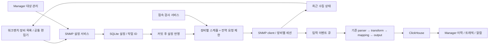

# Logparser SNMP 100대 운영: 구현 및 UI/UX 반영 계획

작성일: 2026-09-07  
상태: 구현 전 계획. 이 문서는 작업 범위와 수용 기준을 제안하며, 제품 구현 완료나 성능 검증 결과를 의미하지 않는다.  
선행 문서: [100대 운영 검토서](../../reviews/2026-09-07-logparser-snmp-100-review.md)

## 1. 목표와 릴리스 범위

**100대의 SNMP 장비를 일괄 등록하고 실제 접속을 검사하며, 무응답 장비가 있어도 정상 장비의 수집 결과를 빠르게 확인할 수 있게 한다.** 기존 Pipeline Studio는 수집 설정과 데이터 가공을 담당하고, 장비 목록은 수집 운영을 담당한다. 장기 이력·트래픽·알람의 중심은 기존 Manager로 둔다.

| 단계 | 완료 후 가능한 운영 | 주요 산출물 |
| --- | --- | --- |
| P0 — 100대 수집 운영 | 일괄 등록 → 접속 검사 → 선택 활성화 → 실패 장비 확인/재검사 | 장비 목록, 접속 검사, 독립 스케줄, 즉시 결과 전달, 설정 충돌 방지, Manager 연결 계약 수정 |
| P1 — 포트·자원 관리 | 모델별 프로필 적용 → 인터페이스 발견 → 수치/추세 조회 | OID 프로필, GET 분할/GETBULK 탐색, 정밀한 counter 처리, Manager 지표/이력 연결 |
| P2 — 운영 체계 | 장애 확인 → 담당자 대응 → 복구/점검 추적 | Manager 알람 상태·점검 제외·변경 감사·역할별 작업, 필요 시 알림 영속 버퍼 |

P0의 기준 부하는 100대 × 20개 고정 OID × 60초다. 24포트 × 6개 항목/포트의 100대 운영은 P1 부하 기준으로 따로 검증한다. P0 완료를 독립적인 전체 NMS 완성으로 표현하지 않는다.

계획의 기본 운영 구조는 단일 Logparser 인스턴스다. 다중 인스턴스 분산 수집·자동 장애 조치·장비 설정 변경용 SNMP SET은 별도 범위다.

## 2. 현재 코드에 근거한 설계 결정

| 확인한 현재 구조 | 계획에서의 결정 |
| --- | --- |
| `SnmpInputAdapter.run()`이 `invokeAll()` 완료를 기다림 | 수집 실행과 이벤트 읽기를 분리하고, 각 장비의 완료 시점에 결과를 큐에 전달 |
| `SnmpPollClient`가 장비별 세션을 재사용 | 동일 v3 사용자명/서로 다른 암호의 격리를 유지. 대상 하나의 세션 초기화 실패를 다른 대상과 분리 |
| `configParams`는 JSON 문자열, targets/OIDs는 내부 배열 | 저장 포맷과 미지정 속성 보존. P0에서는 별도 장비 설정 원장을 만들지 않고 targetId·group·enabled 등 확장 |
| Studio와 Inputs가 `AdapterEditor`를 공유 | SNMP 목록·상세·등록 컴포넌트를 이 공통 편집기에도 재사용 |
| `InputAdapterEntity`에 이미 `@Version`이 있음 | 새 revision 컬럼을 중복 추가하지 않음. 현재 update가 클라이언트 version을 최신 version으로 치환하는 부분을 수정하여 오래된 편집을 감지 |
| 설정 이벤트가 트랜잭션 안에서 발행되고 입력 변경 시 재시작 | SNMP 반영은 커밋 이후 실행. 원하는 설정과 현재 실행 중인 설정 버전을 따로 표시 |
| Manager의 SNMP 대상 CRUD·통합 클라이언트가 존재 | 기존 연동 코드를 교정하고 동일 수집 설정에 대한 독립적인 이중 쓰기를 방지 |

관련 경로는 [구현 파일 지도](#8-구현-작업과-파일-지도)에 정리한다. 문서의 신규 클래스·필드·API 이름은 제안 계약이며 아직 존재하는 기능으로 해석하지 않는다.

### Manager 연동에서 선행 교정할 사항

현재 `SnmpTargetService`는 `configParams`를 Map으로 만들지만 Logparser 저장 계약은 JSON 문자열이다. `LogparserClient.upsertSnmpInputAdapter()`는 실제로는 항상 POST를 호출한다. Manager의 enable/disable은 자체 DB만 수정하며, 생성 응답의 adapter ID를 연결하는 처리도 이 경로에서 확인되지 않는다. 기본 OID는 GET에 필요한 인스턴스 OID인지 다시 검증해야 한다.

P0 연동 작업에서 다음을 처리한다.

- payload 직렬화, 생성/갱신 구분, `logparserAdapterId`와 신규 `logparserTargetId` 연결, enable/disable 전달을 계약 테스트로 고정한다.
- Manager의 credential ID를 실제 인증 설정으로 해석하는 경로를 명확히 구현한다. 미연결 인증을 기본 community로 조용히 대체하지 않는다.
- Logparser 상태 API는 현재 `/api/v1/pipeline/status`, Inputs 경로는 `#inputs`다. 기존 클라이언트의 상태 호출과 deep link를 현재 경로에 맞춘다.
- Manager의 SNMP 화면은 현재 설명 위주의 골격이므로, 완성된 상태판이 있다고 가정하지 않는다.
- Logparser의 `metrics` 객체에서 metric 이름은 key일 수 있다. Manager의 정규화기가 배열 내부 `name`만 기대하지 않도록 객체/배열 양쪽 계약과 partial 상태를 검증한다.

## 3. 백엔드 구조와 데이터 계약



접속 검사는 같은 요청 제한기를 이용하되, 검사 결과를 운영 이벤트 큐와 최근 정기 수집 상태에 섞지 않는다. 입력 어댑터 안에 parser·transform·DB 출력 처리를 넣지 않는다.

### 3.1 설정과 장비 식별

P0의 장비 식별자는 `(collectorInstanceId, adapterId, targetId)`다. `targetId`는 영속 UUID이며 이름/IP/목록 순서가 바뀌어도 유지한다. `collectorInstanceId`는 설치 단위로 지속 보관하고, 복제 설치 시 새 ID를 부여한다. Manager 자산 ID는 별도 연결 키이며 IP만으로 강제 병합하지 않는다.

| 제안 필드 | 위치 / 기본 동작 | 적용 단계 |
| --- | --- | --- |
| `targetId` | `configParams.targets[]`; 기존 대상에 ID 부여, 신규 생성 시 UUID | P0 |
| `enabled` | target 내부; 기존 누락값은 true, UI에서 새로 등록한 대상은 false | P0 |
| `group` | target 내부; 사이트/용도 검색용 선택 문자열 | P0 |
| `intervalMs`, `timeoutMs`, `retries` | target 내부 override; 누락 시 기존 adapter/root 설정 상속 | P0 |
| `credentialMode` | UI 표시 상태; 기본 상속/개별 설정을 기존 보안 필드로 저장 | P0 |
| `oidProfileId`, `oidProfileVersion` | 대상의 수집 프로필 참조; 없으면 기존 root `oids` 적용 | P1 |
| `externalRef` | Manager 등 소유 서비스와 외부 대상 ID의 연결 | P0 연동 |

확장 후에도 REST의 `configParams`는 JSON 문자열이다. 예를 들어 내부 객체는 다음과 같고, 기존 `targets[].version`, 인증 필드, root 기본값을 그대로 함께 사용할 수 있다.

```json
{
  "version": "2c",
  "intervalMs": 60000,
  "retries": 0,
  "targets": [
    {
      "targetId": "dd2b0833-071b-48ca-b952-a19b83015cc4",
      "name": "switch-001",
      "host": "192.0.2.10",
      "port": 161,
      "enabled": false,
      "group": "Seoul / Access"
    }
  ],
  "oids": [{ "name": "sysUpTime", "oid": "1.3.6.1.2.1.1.3.0" }]
}
```

기존 `enabled`는 입력 전체의 스위치다. 실제 대상 활성 조건은 `adapter.enabled && target.enabled`로 정의한다. `workerThreads`와 `queueSize`는 기존 top-level 필드의 우선순위를 유지한다. 대상별 인증 환경변수 참조는 이미 구현된 필드를 재사용한다.

설정의 낙관적 잠금 `version`과 SNMP 프로토콜의 `configParams.version`/`targets[].version`을 DTO와 화면에서 혼동하지 않도록 이름과 설명을 구분한다.

이벤트에는 `collector_id`, `adapter_id`, `target_id`, `poll_id`, `config_version`, `scheduled_at`, `started_at`, `completed_at`을 추가한다. poll_id는 장비의 한 논리 수집마다 생성하며 같은 작업의 네트워크 재시도에서는 유지한다. 기존 `protocol`, `operation`, `target_host`, `observed_at`, `poll_time`, `metrics`는 보존하고 의미를 조용히 바꾸지 않는다. 기존 observed_at/poll_time의 시작 시각 의미는 유지하며 응답 완료 시각을 completed_at으로 분리한다. parser·structured mapping·출력·Manager 정규화까지 식별자가 보존되는 계약 테스트를 추가한다.

중복 endpoint는 자동 삭제하지 않는다. 가져오기에서는 정규화한 host/port와 기존 연결을 비교해 신규·중복 후보·갱신 후보를 보여준다. 둘 이상의 기존 대상과 매칭되면 사용자가 정확한 targetId를 선택해야 한다. 하나의 장비에 여러 수집 목적이 있는 경우도 지원할 수 있도록 targetId 자체의 유일성과 endpoint 중복 경고를 구분한다.

### 3.2 수집 스케줄과 동시 요청

- `run()`은 이벤트 큐에서 다음 결과를 읽는 역할만 수행한다. 스케줄러는 다른 실행 경로에서 장비 작업을 시작한다.
- 장비별 다음 실행 시각과 실행 중 플래그를 유지한다. 같은 target에 정기 수집이 중첩되지 않는다.
- 예정 시각이 밀리면 이미 지난 슬롯을 건너뛰고 다음 유효 슬롯을 잡는다. 지연 횟수를 기록하며 밀린 주기를 연속 재실행하지 않는다.
- 초기 수집을 60초 범위에 고르게 배치해 매분 순간 요청 집중을 줄인다. 최초 수집까지 기다리는 대상은 UI에 ‘첫 수집 대기’와 다음 시각을 표시한다.
- 프로세스 전체 요청 상한을 두고 adapter별 설정도 함께 적용한다. 초기 검증값은 전체 20개, 수동 검사 최대 2개다. 기존 입력의 워커 1 설정은 자동 변경하지 않고, 100대 등록 시 예상 지연과 권장 변경값을 보여준다.
- 실행 대기열은 유한 크기로 두며, adapter별 차례를 번갈아 배정해 특정 수집기/검사가 전역 허용량을 독점하지 않게 한다. 네트워크 대기를 스케줄러 스레드에서 실행하지 않는다.
- 새 UI 기본값과 전역 한도는 100대 부하 시험 후 확정한다. 워커 개수 증가만으로 데이터 신선도를 보장한다고 표시하지 않는다.
- 장비별 세션을 재사용하고 닫힌 세션은 재사용하지 않는다. 인증정보 변경 시 해당 세션만 교체한다. 동일 사용자명·다른 암호의 v3 장비는 계속 격리한다.

작업 결과는 장비 완료 즉시 큐에 넣는다. 큐가 가득 차면 유한 시간 대기 후 결과 유실을 계수하며, 높은 점유율에서는 새 poll 시작을 늦춘다. 무제한 메모리 대기열을 만들지 않는다. 정기 수집 결과, 예약 건너뜀, 큐 드롭, shutdown 중 포기한 결과를 각각 측정한다. 큐 드롭을 ‘SNMP 접속 실패’로 표시하지 않는다.

중단 시 새 예약 차단 → 진행 요청 취소/세션 종료 → 유한 시간 종료 대기 → 남은 결과 계수 순서를 적용한다. 취소·예외의 모든 경로에서 요청 허용량을 반환한다. 초기 종료 목표는 5초이며 테스트에서 확인한다. 설정 변경 전에 시작한 늦은 callback은 target generation과 설정 버전을 확인해 새로운 상태를 덮어쓰지 못하게 한다.

### 3.3 수집 상태 모델

한 개의 status 값에 모든 의미를 넣지 않는다.

| 상태 축 | 제안 값 / 기준 | UI 표현 |
| --- | --- | --- |
| 설정 | enabled / disabled | 수집 중 / 수집 중지 |
| 설정 반영 | pending / applying / applied / partial / failed | 저장됨·적용 중·일부 적용 실패·적용됨 |
| 최근 poll | unknown / success / partial / error | 첫 수집 대기·정상·일부 항목 실패·응답 실패 |
| 신선도 | never / fresh / stale | 최근 성공 시각과 데이터 지연 배지 |
| 결과 전달 | queued / dropped; 저장 확인은 별도 | 큐 전달/유실, DB 저장 여부 미확인 |

응답 시간, 마지막 실행/응답/완전 성공 시각, 다음 실행 예정, 연속 실패 수, OID 성공/실패 수, scheduler 지연, 마지막 오류 코드와 설정 버전을 제공한다. 시간은 UTC로 전달하고 화면은 사용자 시간대로 표시한다.

`lastResponseAt`과 `lastFullSuccessAt`을 나누어 partial이 완전 성공 시각을 갱신하지 않게 한다. UI 요약의 지연 기준은 초기안으로 `max(2 × intervalMs, intervalMs + 대상별 요청 deadline)`을 사용하고 기준을 상세에 노출한다. 장비 전체의 최신성만으로 개별 OID의 최신성을 보장하지 않으며, P1에서 OID별 누락 시각을 제공한다.

정상/일부 실패/응답 실패/대기/수집 중지는 상호 배타적인 기본 집계로 합계가 전체 대상 수와 같아야 한다. ‘데이터 지연’과 ‘적용 실패’는 중첩될 수 있는 추가 배지다. SNMP timeout을 장비 전원 장애나 인증 실패로 단정하지 않는다. 명확한 SNMPv3 report가 있을 때만 인증 원인을 특정한다.

P0 상태는 메모리 저장소를 사용하고 API에 `runtimeEpoch`, `snapshotAt`을 포함한다. 서버 재시작 후에는 unknown으로 시작한다. 이전 프로세스의 성공 상태를 현재 상태로 되살리지 않는다. 브라우저/API 통신 실패 시 마지막 표시값을 유지하면서 ‘갱신 끊김’을 표시한다.

### 3.4 설정 저장·적용·충돌 처리

1. 서버는 요청의 expected version과 DB `@Version`을 확인하고, 대상 전체 변경을 먼저 검증한다. stale 편집은 409로 반환한다.
2. 대상 수정·일괄 변경은 adapter 설정 하나에 대해 원자적으로 저장한다. 여러 adapter 변경은 adapter별 결과를 반환하며 전체 원자성을 약속하지 않는다.
3. DB 커밋 이후 변경 대상만 reconcile한다. `desiredVersion`과 target별 `appliedVersion`, 적용 결과를 따로 노출한다.
4. 이름/그룹 변경은 세션 재연결 없이 반영한다. IP·인증·수집 설정 변경은 해당 대상만 반영한다. message type, adapter type 또는 큐 구조 변경은 입력 전체 재시작으로 분류하고 UI에 영향 범위를 표시한다.
5. 적용 실패 시 이전에 실행 중이던 정상 대상은 유지한다. 저장됐지만 실행에 반영되지 않은 설정은 실패 배지와 재시도/직전 설정으로 되돌리기를 제공한다. ‘되돌리기’도 최신 version 기준의 새 변경이다.
6. 재시작이나 커밋 직후 프로세스 종료가 있어도, 시작 시 DB의 원하는 설정을 다시 읽어 reconcile한다. 커밋 전 시작한 수집을 성공 적용으로 간주하지 않는다.

기존 SNMP 전체 PUT 경로도 같은 정규화·충돌 검사·반영 경로를 거친다. 신규 API만 안전하게 만들고 기존 UI/Manager 경로가 이를 우회하지 않게 한다. version 없는 기존 클라이언트는 전환 기간에 식별하고, UI/Manager 업그레이드 후 SNMP 변경 요청에 version 요구를 적용한다. 호환 읽기와 기존 JSON 포맷은 유지한다.

외부 중복 요청은 `operationId`로 식별한다. 설정 변경과 작업 결과 식별자를 같은 트랜잭션에서 저장하는 작은 작업 테이블을 추가해, 저장 후 응답 유실 시 같은 작업 ID로 결과를 조회한다. 원문 비밀번호는 작업 기록에 넣지 않는다. 같은 ID에 다른 변경 내용이 오면 충돌로 반환한다. 실제 수집 callback까지 exactly-once라고 주장하지 않는다.

통합 목록에서 여러 adapter의 대상을 선택하면 입력별 expectedVersion과 하위 operationId로 요청을 나누고, 화면은 성공/실패를 합산한다. 작업 기록은 초기 30일 보존을 제안하며 중복 방지 보장 기간을 API에 명시한다. 보존 기간이 지난 생성 재시도는 기존 targetId/externalRef 연결을 먼저 조회해 중복 생성을 막는다.

### 3.5 설정 소유권과 Manager

- `externalRef.owner=manager`인 대상은 Manager가 원하는 장비 설정의 원장이다. 워크벤치에서는 상태/진단과 소유 화면으로 이동을 제공한다. 공용 수집기 설정을 바꿔 Manager 대상에 영향을 줄 때도 소유 정책을 검사한다.
- 워크벤치에서 생성한 대상은 Logparser가 원장이다. Manager는 자산 연결과 상태 조회를 수행하고, 소유권 이전 없이 별도 사본을 갱신하지 않는다.
- 양쪽 DB와 HTTP 호출을 하나의 트랜잭션으로 취급하지 않는다. Manager는 원하는 변경을 먼저 저장하고, 동기화 작업 ID·연결 ID·버전·실패 원인을 기록해 재시도한다.
- 기존의 장비당 adapter 구성은 우선 연결을 복구한다. 공통 프로필의 장비를 하나의 adapter로 통합하는 작업은 P1의 별도 미리보기/이관 작업으로 진행한다.

## 4. API 반영 계획

아래 경로는 `/api/v1` 기준의 신규 제안이다. 조회 DTO는 인증정보를 포함하지 않는다. 저장은 기존 설정 서비스와 검증 로직을 경유한다.

| 메서드 / 경로 | 역할과 주요 계약 |
| --- | --- |
| `GET /snmp/targets` | 입력 간 장비 통합 목록. adapter/group/query/pollStatus/freshness/page/size/sort. summary와 페이지가 같은 snapshot 기준 |
| `GET /snmp/targets/{adapterId}/{targetId}` | 상세 설정 요약, 최근 수집 상태, 적용 버전. 비밀값은 마스킹 |
| `POST /snmp/targets/preview` | 붙여넣기/CSV 파싱 후 후보 목록 검증. 행별 오류·중복 후보·예상 변경·상속 결과. DB 저장/네트워크 호출 없음 |
| `POST /snmp/config-operations` | `operationId`, `adapterId`, `expectedVersion`, 변경 대상/값으로 생성·수정·활성화를 저장. 반환값은 저장 결과와 적용 추적 ID |
| `GET /snmp/config-operations/{operationId}` | desired/applied 상태, 대상별 실패, 재시도 가능 여부 |
| `POST /snmp/probes` | 저장된 대상 ID 또는 미저장 draft의 실제 GET 검사. 202와 jobId 반환 |
| `GET /snmp/probes/{jobId}` | queued/running/success/partial/error/cancelled/expired, 대상별 결과/시간/오류/OID 상태 |
| `DELETE /snmp/probes/{jobId}` | 아직 실행 안 한 요청을 취소하고 진행 중 요청 종료 시도. 이미 발생한 네트워크 요청은 되돌렸다고 표시하지 않음 |
| `GET /snmp/runtime` | 전역/입력별 요청 수·스케줄 지연·드롭·큐·적용 상태 |
| `POST /snmp/discoveries` | P1. 선택 대상과 허용 subtree의 인터페이스/OID 발견 작업 |

접속 검사는 최대 100대/job, 동시 요청 최대 2개, job 전체 최대 10분을 초기 상한으로 둔다. 개별 요청 deadline은 설정과 별도로 제한하며, v3 초기 교환도 deadline에 포함한다. 작업 수·결과 크기·보존 시간에 상한을 둔다. 완료 결과는 기본 10분 보존하고 브라우저에는 비밀값을 반환하지 않는다. 검사 중 상태 조회는 1초, 일반 장비 상태는 5초 간격으로 시작하며 화면이 숨겨지면 중지/완화한다.

검사 API는 실제 네트워크 요청을 발생시키므로 기존 관리 접근 통제 안에 두고 서버 측 허용 대상 범위를 적용한다. 설정 저장과 검사 로그에서 secret을 제외하고, SNMP 오류와 API 권한 오류를 구분한다. 검사로 확인할 수 있는 것은 SNMP 응답이며 pipeline 출력 성공이나 DB 저장 성공이 아니다.

## 5. UI/UX 반영 계획

현재 shadcn/AppShell·헤더·색상·간격·입력 컴포넌트를 재사용한다. 이 문서는 화면 구성과 동작 명세이며, 실제 화면 시안의 검수 완료를 의미하지 않는다. 구현 시작 시 현재 화면을 캡처하고 아래 흐름별 데스크톱/모바일 시안을 검토한다.

### 5.1 화면별 역할과 진입 경로

| 화면 | 변경 내용 | 운영자가 끝낼 수 있는 작업 |
| --- | --- | --- |
| Overview | ‘SNMP 수집 대상’ 요약과 실패/지연 수, 장비 목록 연결 | 문제가 있는 장비로 이동 |
| 신규 SNMP Devices | 공통 Workspace 메뉴 안의 통합 장비 목록 | 100대 검색·필터·선택·실제 검사 |
| Pipeline Studio → SNMP Input | 상태 요약, 선택 입력의 장비 목록 링크, 공통 편집기 | 수집 경로와 해당 장비 설정 연결 |
| AdapterEditor → Targets | 카드 100개를 목록+선택 상세로 교체 | 장비 일괄 등록과 개별 수정 |
| AdapterEditor → OIDs | 대상 목록에서 수집 항목을 별도 탭으로 분리 | 공통 OID/MIB/향후 프로필 설정 |
| Live Tail | adapterId/targetId/pollId 필터 연결 | 특정 장비 원문과 파싱 결과 진단 |
| Manager SNMP/자산/Traffic/Alerts | 동일 식별자로 상태·지표·이력·알람 연결 | 장기 추세와 장애 대응 |

제안 deep link는 `#snmp?adapterId=...&targetId=...&status=...`다. `workspace.tsx`의 route 모델을 확장하고, 기존 `#studio?type=...` 링크는 그대로 유지한다. 장비 목록에서 Studio로 이동할 때 message type만으로 모호하지 않도록 선택 adapterId도 전달한다.

### 5.2 장비 목록 구성

| 영역 | 구성 |
| --- | --- |
| 상단 | 제목, 마지막 갱신 시각, 새로고침, 장비 추가, 일괄 등록 |
| 요약 | 전체 / 정상 / 일부 실패 / 응답 실패 / 첫 수집 대기 / 수집 중지. 데이터 지연은 별도 중첩 지표 |
| 필터 | 이름·IP 검색, 수집기, 그룹, 수집 상태, 데이터 지연. URL에 유지 |
| 기본 열 | 선택, 상태, 장비명/IP, 그룹, 최근 응답, 최근 완전 성공, 응답 시간, 활성 상태, 작업 |
| 선택 작업 | ‘현재 페이지 25대 선택’과 ‘필터 결과 100대 선택’을 구분. 접속 검사, 그룹 변경, 활성/중지 |
| 하단 | 기본 25행, 25/50/100 선택, 결과 수와 페이지 |
| 상세 | 선택 장비의 요약/접속·인증/수집 항목/최근 검사. 긴 이력은 Manager로 연결 |

100대에서는 테이블 페이지 처리부터 적용하고, 편집 중인 장비 한 대의 폼만 렌더링한다. 데이터 필터링 비용과 실제 성능을 측정한 후 필요할 때만 가상 스크롤을 추가한다. 새 상태 응답 때문에 정렬·스크롤·선택·편집값이 튀지 않게 한다. 키는 배열 index 대신 targetId를 사용한다.

데스크톱은 목록과 상세 패널, 작은 화면은 핵심 열을 줄인 목록과 전체 폭 상세 화면을 사용한다. 필터·선택 범위·뒤로 가기 위치를 유지한다. 데이터 테이블 내부의 가로 스크롤이 필요하면 해당 영역만 스크롤하며, 페이지 전체가 옆으로 밀리지 않게 한다.

### 5.3 일괄 등록 흐름


CSV의 초기 열은 `name,host,port,group`이며 추가 열은 enabled, intervalMs 등 승인된 필드로 제한한다. 수집기와 인증 기본값은 화면에서 선택한다. CSV에 비밀번호를 넣도록 유도하지 않는다. 미리보기에는 원본 행 번호를 유지한다.

- 신규/중복/수정/오류 건수를 표시하고, 잘못된 IP/포트·빈 host·충돌을 행에 연결한다.
- ‘오류 수정 후 전체 저장’과 ‘유효한 행만 선택 저장’을 구분한다. 일부만 저장하면 제외된 행과 이유를 결과에 남긴다.
- 검사 결과는 완료 순서대로 표시하고, 취소·실패만 재검사를 제공한다. 검사 도중에도 완료 결과를 읽을 수 있다.
- SNMP 응답 실패는 설정 저장 자체의 오류로 처리하지 않는다. 유효한 설정은 비활성으로 저장할 수 있다.
- 저장 결과는 ‘저장 98대 / 제외 2대’처럼 표현한다. 활성화는 선택 대상을 명시하고 별도의 정상 흐름 단계로 제공한다. 기존 ‘Save input’과 충돌하는 숨은 자동 활성화를 만들지 않는다.
- 실패한 저장/응답 유실의 재시도는 같은 operationId를 사용해 중복 장비 생성을 막는다.

### 5.4 단건 편집·상속·저장 피드백

인증·주기·OID는 ‘기본값 상속’과 ‘이 장비에서 변경’을 명시한다. 상속 중인 값의 출처와 실제 적용값을 표시하며, 비밀값은 설정 여부만 보여준다. 장비 상세에서 수정해도 Studio/Inputs에서 같은 값과 적용 상태가 보여야 한다.

편집값은 상위 draft 상태에 두어 탭 전환/페이지 전환 준비 중 잃지 않게 한다. 무거운 숨김 탭을 모두 forceMount하지 않아도 입력이 보존되게 한다. 저장되지 않은 변경 표시, 행별 유효성 오류, 저장 중 버튼 중복 실행 방지, 저장 후 선택 위치 유지가 필요하다.

기존 입력 전체 저장은 유지한다. 장비 목록에서는 선택 target 변경만 보내는 동작을 제공한다. ‘저장’ 후 DB 완료와 runtime 적용 결과를 따로 표시하고, 409 충돌에서는 내 변경을 보관한 채 새 버전과 차이를 보여준다. 자동 덮어쓰기하지 않는다.

### 5.5 테스트와 오류 문구

| 동작 / 상황 | 제안 문구와 행동 |
| --- | --- |
| 실제 요청 | `Test SNMP connection` — 선택 장비에 실제 요청을 보냅니다 |
| 입력 예제 검사 | `Preview sample payload` — 예제 데이터의 구조를 확인합니다 |
| parser/transform 검사 | 기존 단계 테스트 유지 — 현재 draft와 입력 샘플을 명시 |
| timeout | ‘SNMP 응답 없음. 주소·네트워크·접근 허용 설정을 확인하세요.’ 명확하지 않으면 인증 실패라고 단정하지 않음 |
| 일부 OID 실패 | ‘20개 중 3개 항목 응답 없음’과 해당 OID로 이동 |
| 오래된 데이터 | 마지막 확인값과 시각을 유지하고 ‘데이터 지연’ 표시 |
| API 접속 실패 | ‘상태 갱신이 중단되었습니다’와 재시도. 장비 수를 0으로 바꾸지 않음 |
| 저장 후 적용 실패 | ‘설정은 저장됐지만 2대에 적용되지 않았습니다’와 대상 목록/재시도 |
| 전체 입력 재시작 필요 | 영향을 받는 장비 수와 수집 중단 가능성을 저장 미리보기에 표시 |

언어는 해당 화면의 기존 언어와 일관되게 적용한다. 문구를 한곳에 모아 두고 기존 영문 콘솔을 부분적으로 무작정 번역하지 않는다. 사용자가 판단하는 데 필요하지 않은 JSON 경로나 executor 이름은 고급 상세에만 표시한다.

### 5.6 접근성·반응형·상태 보존

- 상태를 색상만으로 전달하지 않고 텍스트/아이콘을 함께 사용한다.
- 표 헤더, 정렬 버튼, 체크박스의 장비명과 선택 범위를 스크린리더가 읽을 수 있게 한다.
- 키보드로 필터 → 행 선택 → 상세 → 저장/취소까지 완료할 수 있게 한다. 상세를 닫으면 원래 행으로 포커스를 반환한다.
- 검사 진행 상태는 적절한 live region으로 요약하되 100대 응답을 모두 읽어 주지 않는다.
- 오류 요약에서 해당 행/필드로 이동하고, 입력값을 지우지 않는다.
- 데스크톱 1440/1280px, 작은 화면 390px, 확대 200%에서 실제 흐름을 확인한다. 이 수치는 검증 대상이며 현재 충족했다는 뜻이 아니다.

## 6. P1: OID 프로필·발견·수치 처리

OID 프로필은 이름·설명·버전·선택 OID·단위·counter 종류·인터페이스 인덱스 규칙을 가진 재사용 설정으로 만든다. P0의 기본 인증 상속은 유지하고, 별도 인증 프로필은 기존 비밀정보 저장 경계를 검토한 뒤 추가한다.

- 프로필은 버전을 고정해 참조한다. 수정한 프로필이 즉시 모든 장비를 바꾸지 않도록 적용 대상/변경량을 미리 보여준다. 사용 중인 버전은 제거하지 않는다.
- MIB 가져오기는 OID 후보 생성이다. 실제 장비의 인터페이스 발견과 UI 동작을 구분한다.
- GET은 초기 `maxOidsPerRequest` 제안값 20으로 분할하되, 개수만으로 메시지 크기를 보장하지 않는다. `tooBig`이면 요청을 축소하며 단일 OID도 실패하면 원인을 보고한다.
- GETBULK는 v2c/v3의 지정 subtree 탐색에 사용하고 v1은 GETNEXT로 처리한다. 최대 행/OID/소요 시간, subtree 이탈, 반복 OID, 비정상 agent 응답에 대한 종료 조건을 둔다. 무제한 WALK를 만들지 않는다.
- 다수 요청의 결과를 장비 단위로 합치되 target deadline을 둔다. 한 chunk가 실패해도 나머지 값을 partial로 보존하고 OID별 관측 시각/실패 사유를 남긴다.
- `ifIndex`, `ifName`, `ifAlias`, `ifHighSpeed`, counter/discontinuity를 함께 연결한다. 재부팅·인덱스 변경 시 자동 연결을 재확인한다.
- raw Counter64 문자열을 BigInteger/정확한 정수 표현으로 읽고 차분을 계산한 후 rate를 실수로 변환한다. 기존 Float64에 저장한 누적값만으로 정밀 차분을 계산하지 않는다.
- 같은 target/interface/metric/설정 세대의 연속 관측만 비교한다. 첫 샘플, 역순/중복, 재부팅, 불연속, 불확실한 wrap은 rate를 null로 두고 이유를 표시한다. 실제 Δtime을 사용한다.
- 가공과 출력 책임은 기존 파이프라인 및 Manager telemetry 경계에 둔다. 수집 어댑터 안에 DB 질의나 트래픽 화면 계산을 넣지 않는다.
- ClickHouse 직접 telemetry와 Manager raw 정규화가 같은 canonical metric을 이중 저장하지 않도록 배포 경로별 작성 주체를 하나로 정한다. pollId/targetId/metric key를 이용해 재처리 중복을 검증한다.

P1 UI는 ‘프로필 선택 → 발견 → 인터페이스 선택 → 수집량 미리보기 → 적용’ 순서다. 적용 전에 장비 수/OID 수/예상 요청 수와 기존 항목의 추가·제거를 표시한다. 트래픽 그래프의 결측은 0으로 그리지 않는다.

## 7. P2: 이력·알람·변경 운영

Manager의 기존 자산·Traffic·Alert 구조를 재사용한다. 워크벤치에서는 장비 ID와 시간 범위를 전달하는 연결 및 최근 수집 진단을 제공한다.

- 알람에는 응답 실패, 연속 실패, 중요 OID의 partial, 데이터 지연, 출력 유실을 별도 조건으로 정의한다.
- 발생/확인/복구, 중복 억제, 점검 기간 제외를 상태로 저장한다. 점검 제외는 기본적으로 알람 억제이며 수집 중지와 구분한다.
- Trap/Inform은 장비·trap OID별 규칙으로 분류하고 poll 상태와 상관 관계를 보여준다. 수신만으로 장비 전체 복구를 선언하지 않는다.
- 변경 기록에는 작업자, 시각, 변경 대상, 민감값을 제외한 전후 차이, 저장/적용 결과, 연계 operationId를 남긴다.
- Manager의 기존 역할/인증 체계를 확인해 조회·접속 검사·설정 변경 권한을 연결한다. UI 버튼 숨김뿐 아니라 API에서 권한을 검사한다.
- Inform의 ACK를 최종 저장 보장으로 바꾸지는 않는다. 영속 수신이 업무 요건이면 디스크 수락 후 ACK, 용량 상한, 재시작 재처리, 중복 식별을 별도 작업으로 설계하고 장애 주입으로 검증한다.

## 8. 구현 작업과 파일 지도

아래 작업 단위는 PR로 나눌 수 있으며, 명시된 테스트는 구현 단계에서 실행한다. 이번 계획 작성에서 새 제품 테스트를 실행했다는 의미가 아니다.

| 작업 | 변경 위치 / 신규 제안 | 완료 기준 | 의존 |
| --- | --- | --- | --- |
| T0. 계약 고정 | 현재 SNMP/Manager DTO와 테스트 fixture, 설정/이벤트 샘플 | 기존 v1/v2c/v3·partial·Counter64·객체형 metrics 계약, baseline 부하 기록 | 시작 |
| T1. ID·설정 정규화·버전 | `domain/configuration/model`, `ConfigManagementService`, `ConfigValidationService`, `ConfigMetadataService`, entity/repository/Flyway, `InputAdapterController` | 기존 설정 변환, unknown 속성 유지, stale 저장 409, 작업 ID 재시도 | T0 |
| T2. 수집 실행 분리 | `domain/input/model/snmp/SnmpInputAdapter`, `SnmpPollClient`, `SnmpSession`; 신규 `SnmpPollScheduler`, `SnmpRequestLimiter`, `SnmpRuntimeRegistry` | 정상 장비 즉시 전달, 전역 상한, 독립 스케줄, 유한 큐·종료, 장애 세션 격리 | T1 |
| T3. runtime 반영·상태 API | `application/pipeline/InputAdapterComponent`, `PipelineConfigEventListener`, `domain/input/service/InputFactory`; 신규 SNMP 상태/설정 반영 서비스 및 controller/DTO | 커밋 이후 반영, 변경 대상만 적용, desired/applied 노출, 늦은 callback 격리 | T2 |
| T4. 실제 검사·일괄 API | 신규 `application/service/SnmpProbeService`, `SnmpTargetConfigurationService`, `interfaces/controller/SnmpOperationsController` | draft/저장 장비 검사, 취소/TTL/상한, 행별 검증, 중복 저장 방지 | T1–T3 |
| T5. 장비 UI·공통 편집 | `frontend/src/features/snmp-devices.tsx` 신규; `components/adapters/snmp-target-table.tsx`, `snmp-target-editor.tsx`, `snmp-target-import.tsx`, `snmp-probe-panel.tsx` 신규; 기존 `adapter-form`, `collection-fields`, `adapter-definitions` | 100대 등록/필터/선택/검사, 상속 표시, dirty/충돌/적용 오류 처리 | T1 계약, T3–T4 |
| T6. 워크벤치 연결 | `frontend/src/App.tsx`, `lib/workspace.tsx`, `lib/types.ts`, `components/layout/app-shell.tsx`, `features/overview.tsx`, `pipeline-studio.tsx`, `live-tail.tsx` | 링크 복귀/선택 보존, input 예제와 실제 검사 구분, 상태 요약 | T5 |
| T7. Manager 연동 | `manager/.../snmp/SnmpTargetService`, `SnmpTargetRequest`, `integration/LogparserClient`, `telemetry/TelemetryNormalizer`, 관련 migration/test | payload·생성/갱신·ID·버전·활성 동기화·재시도·소유권 계약 | T1–T4 |
| T8. P0 통합 검증/문서 | 양쪽 Java/UI 테스트, 100 endpoint simulator, SNMP 문서 | 아래 P0 종료 기준 충족, 실제 화면 확인, 회귀·복구 절차 기록 | T2–T7 |
| T9. OID/지표 확장 | SNMP client/프로필 서비스, MIB UI, `ClickHouseOutputAdapter`, Manager telemetry/Traffic | 발견/분할/partial/정밀 차분/중복 방지와 포트 부하 시험 | P0 |
| T10. 이력/알람 운영 | Manager SNMP/Assets/Traffic/Alerts, audit/maintenance 경로 | 장비 단위 발생→확인→복구, 결측/점검 구분, 권한 검증 | T9 |

공유 스케줄러/상태 저장소는 Spring 관리 서비스로 구성한다. production factory에서 SNMP 어댑터에 주입하는 경로를 명시적으로 추가한다. 기존 public `InputAdapterConfig` 생성자와 타입 alias를 유지하되, 이를 통한 독립 생성과 production의 전역 요청 제한 사용을 구분해 테스트한다. static 전역 서비스 탐색이나 다른 입력 어댑터의 불필요한 재설계를 피한다.

T1의 migration은 현재 마지막 migration 다음 번호를 구현 시 확인해 사용한다. targets ID 보강, 작업 식별자 저장, Manager 연결 필드 변경을 각각 검토하고 기존 V1/V9 파일을 덮어쓰지 않는다. P1 프로필 저장소가 추가되면 별도 migration으로 진행한다.

## 9. 검증 계획과 출시 기준

### 9.1 기능·통합 검증

| 시험 | 반드시 확인할 내용 |
| --- | --- |
| 스케줄/전달 단위 시험 | 빠른 대상의 결과가 느린 대상 완료 전에 전달됨. clock/제어된 future로 검증해 단순 sleep 시간만 비교하지 않음 |
| 동시성/공정성 | 여러 adapter와 수동 검사 합계가 상한 이하. 동일 대상 중첩 없음. 오류/취소 후 허용량 누수 없음 |
| 큐/중단/재시작 | 출력 중단 중 메모리 상한, 드롭/예약 건너뜀 계수, 5초 종료, 이전 generation 결과 배제 |
| SNMP protocol | v1/v2c/v3와 v3 사용자 격리, timeout, noSuchInstance, partial, 큰 counter, Trap/Inform 기존 회귀 |
| 설정/호환성 | 신규/기존 DB, 기존 JSON round trip, ID 보존, target enabled 상속, 409, operationId 재시도, 커밋 후 적용 실패 |
| 실제 검사 | draft 변경 후 이전 결과 stale 표시, 검사 결과가 정기 수집 상태/DB metric을 변경하지 않음 |
| Manager 계약 | 실제 Logparser controller를 상대로 직렬화·갱신·enable/disable·연결 ID·버전·재시도·객체형 metrics 검증 |
| UI 흐름 | 100대 가져오기, 오류 행 수정, 25/100대 선택 범위, 검사 취소/재검사, 저장/적용 구분, 뒤로 가기·dirty 상태 |

가상 API만으로 화면 검증을 끝내지 않는다. typed fixture와 실제 응답 schema 계약 테스트를 먼저 통과시키고, 별도 SQLite DB의 실제 backend와 frontend를 연결해 핵심 흐름을 검증한다. 이전 검토에서 fixture 형식 불일치로 화면을 검증하지 못한 문제를 반복하지 않는다.

### 9.2 100대 부하 시나리오

시험 환경의 OS, CPU/RAM, JVM/heap, SNMP 버전, OID/응답 크기, 지연 분포, timeout/retries, 워커, 저장소를 결과에 기록한다. loopback에서 포트가 다른 100개 SNMP 응답기를 사용하고, 이후 대표 실장비로 호환성을 확인한다. simulator 100개가 실제 장비 100대 검증과 같다고 보고하지 않는다.

1. 100대 정상, 20 OID, 60초, 응답 10–200ms, 24시간.
2. 20대 무응답/80대 정상, 무응답 대상의 배치 순서를 섞어 반복.
3. 전체 무응답과 복구, 재시도 0/1, v3 초기 엔진 교환 포함.
4. 일부 OID 실패, 장비 한 대의 비정상 응답, 일부 세션 초기화 실패.
5. 출력 저장소 5분 중단/복구, 큐와 적용 중 설정 변경.
6. 정기 수집과 100대 수동 검사 동시 실행, 취소 후 정상화.
7. Trap/Inform의 집중 유입. 입력률을 기록하고 ACK·중복·드롭·저장 결과를 구분.
8. P1에서 24포트 × 6항목 × 100대의 요청 분할과 일별 저장량/메모리 검증.

### 9.3 제안하는 P0 종료 기준

| 기준 | 목표 / 측정 정의 |
| --- | --- |
| 정상 장비 신선도 | 초기 2주기 이후, 정상 및 20% 무응답 시나리오의 정상 장비에서 `현재 시각 - 마지막 정상 관측 시각` p95 ≤ 90초 |
| 완료 결과 전달 | SNMP 응답 완료 → dispatcher 수락 p95 ≤ 1초. 저장소 정상·과부하 없음 조건; DB flush 지연은 별도 측정 |
| 정상 조건 유실 | 24시간에 생성 완료한 pollId 대비 정상 출력 저장 결과 누락 0. 경계 시각의 단순 예상 건수만으로 판단하지 않음 |
| 장애 영향 | 20대 실패 중 정상 80대의 수집 지속, 첫 수집 완료 결과가 실패 장비의 전체 완료를 기다리지 않음 |
| 자원 제한 | 실제 동시 요청이 설정 상한 이하, 대기열/검사 결과 상한 준수, 취소 후 누수 없음. heap/스레드/소켓의 지속 증가 없음 |
| 화면 반응 | 기준 PC·1440px·100대 fixture에서 목록 필터/선택의 화면 반영 p95 ≤ 200ms, 편집값 손실 없음 |
| 운영 작업 | 유효 CSV 100행 등록 설정 완료 5분 이내, 장애 장비 찾기 30초 이내를 사용자 시험 목표로 사용. 네트워크 검사 대기 시간은 별도 기록 |
| 회귀/접근성 | Java/UI 필수 테스트 통과, 실제 desktop/mobile 흐름과 키보드 작업 완료 |

수치는 출시 전 검증할 목표다. CPU 사용률·디스크 용량은 baseline 측정 후 예산을 확정하며, 측정 없이 특정 서버 사양으로 100대를 보장하지 않는다.

구현 후 필수 명령은 Logparser의 `gradlew.bat test`, `gradlew.bat build`, frontend의 `npm test`, `npm run build`다. Manager 변경 시 해당 서비스의 테스트/빌드도 수행한다. 기존 프런트엔드 시간 초과는 재발 여부를 확인하고, 근거 없이 timeout만 늘려 통과시키지 않는다.

## 10. 이행·출시·복구 계획

- 사전 단계: 기존 설정과 DB를 백업하고, 검토 당시 작업 트리의 SNMP 변경을 기준 버전으로 고정한다. 변경 중인 코드를 정리하지 않은 상태에서 migration을 겹쳐 작성하지 않는다.
- P0 내부 검증: ID/설정 마이그레이션과 신규 API를 먼저 제공하고, 내부 테스트용 scheduler 전환 설정으로 기존/신규 동작을 비교한다. 제품 일반 사용자에게 내부 전환 옵션을 노출하지 않는다.
- P0 시범 적용: 5대 → 20대 → 100대. 각 단계에서 최소 2개 정상 수집 주기와 장애/복구 확인, 100대에서는 24시간 검증을 수행한다.
- Manager 연결: 기존 adapter와 대상 ID를 매칭한 미리보기를 검토하고, 연결이 없는 장비를 무조건 POST로 복제하지 않는다. 한쪽 설정의 소유권을 정한 후 쓰기 경로를 전환한다.
- 복구: 앱 버전만 내리면 신규 target.enabled/override를 구버전이 무시할 수 있다. 이전 설정/DB의 백업과 함께 되돌리거나, 새 설정을 보존하는 호환 런타임을 사용한다. 진행 중인 설정 작업과 영속 버퍼가 있으면 상태를 기록하고 중복/누락을 확인한다.
- 완료 문서: `logparser/README.md`, `readme/snmp.md`, `readme/logparser_schema.md`, `readme/logparser-user-manual.md`, `readme/diagram_samples.md` 및 Manager 연동 문서를 갱신한다.

## 11. 일정과 실행 순서

백엔드 1명·프런트엔드 1명, QA/운영자의 부분 참여를 가정한 초기 추정이다. 실제 인력 배정이나 납기 약속은 아니며, T0 baseline과 계약 고정 후 재산정한다.

| 묶음 | 작업량 추정 | 두 개발자가 참여할 때의 달력 기간 | 종료 조건 |
| --- | --- | --- | --- |
| P0 | 약 25–40 인일 | 약 4–6주 | T0–T8 및 100대 출시 기준 |
| P1 | 약 20–30 인일 | 추가 약 3–5주 | 프로필/발견/지표·포트 부하 검증 |
| P2 | 약 15–25 인일 | 추가 약 3–4주 | 알람/이력/권한/점검 흐름. 영속 Inform 버퍼는 별도 산정 |

T1 계약을 먼저 고정하면 T2–T4 백엔드와 T5–T6 UI 작업을 병행할 수 있다. T7 Manager 계약 수정은 P0 통합 검증 전에 끝낸다. 소유권/버전/식별자 변경을 뒤로 미루면 목록과 일괄 저장을 다시 수정해야 하므로 선행한다.

첫 구현 묶음은 **T0–T3: 계약·장비 ID·독립 수집·상태 API**, 다음 묶음은 **T4–T7: 실제 검사·일괄 등록·워크벤치·Manager 연결**, 마지막은 **T8: 100대 통합 검증**으로 진행한다.

## 12. 출처와 변경 추적

- [Logparser 내부 가이드](../../../logparser/AGENTS.md)
- [수집기](../../../logparser/src/main/java/org/keinus/logparser/domain/input/model/snmp/SnmpInputAdapter.java), [SNMP client](../../../logparser/src/main/java/org/keinus/logparser/domain/input/model/snmp/SnmpPollClient.java)
- [설정 서비스](../../../logparser/src/main/java/org/keinus/logparser/domain/configuration/service/ConfigManagementService.java), [입력 entity](../../../logparser/src/main/java/org/keinus/logparser/infrastructure/persistence/entity/InputAdapterEntity.java)
- [공통 편집기](../../../logparser/frontend/src/components/adapters/adapter-form.tsx), [대상 폼](../../../logparser/frontend/src/components/adapters/collection-fields.tsx), [Studio](../../../logparser/frontend/src/features/pipeline-studio.tsx), [레이아웃](../../../logparser/frontend/src/components/layout/app-shell.tsx)
- [Manager 대상 서비스](../../../manager/src/main/java/org/castrelyx/manager/snmp/SnmpTargetService.java), [연동 client](../../../manager/src/main/java/org/castrelyx/manager/integration/LogparserClient.java), [정규화기](../../../manager/src/main/java/org/castrelyx/manager/telemetry/TelemetryNormalizer.java), [SNMP 화면](../../../manager/frontend/src/views/SnmpDashboardView.tsx)
- [기존 Manager NMS 계획](2026-06-09-castrelyx-manager-full-nms-v1.md): 책임 경계 참고. 기재된 기능의 구현 완료 여부는 현재 코드를 기준으로 확인한다.

이번 작성에서는 계획 문서와 검토서의 연결만 추가했다. 제품 코드·DB·운영 수집 설정은 변경하지 않았다.
